# MayDay - Hệ thống quản lý khám bệnh & theo dõi mề đay (DrMayDay)

> Nguồn: [DR_MayDay.pdf](DR_MayDay.pdf), 363 trang. Bản chuyển đổi giữ phần mô tả, yêu cầu, thiết kế dữ liệu, đặc tả API và các tình huống kiểm thử; lược bỏ mục lục lặp, số trang trình chiếu và trang kết thúc. Các bảng vốn là ảnh được giữ trong thư mục `MayDay_assets` và nhúng tại vị trí tương ứng. Số trang PDF được ghi để tiện đối chiếu.

## Mục lục

- [Mô tả và yêu cầu dự án](#mo-ta-du-an)
- [Đặc tả API](#dac-ta-api)
  - [Phần 1: Xác thực & Quản lý tài khoản người dùng](#api-phan-1)
  - [Phần 2: Quản trị Người dùng, Vai trò & Quyền hạn (Admin Module)](#api-phan-2)
  - [Phần 3: Quản lý Cơ sở vật chất & Hạ tầng tổ chức (Topology)](#api-phan-3)
  - [Phần 4: Quản lý Bệnh nhân và Hồ sơ Bệnh án (Medical Records)](#api-phan-4)
  - [Phần 5: Đánh giá Thang điểm Mề đay (UAS7 Score)](#api-phan-5)
  - [Phần 6: Quản lý Đơn thuốc & Cận lâm sàng (Prescriptions & Labs)](#api-phan-6)
  - [Phần 7: Quản lý Kho ảnh & Tệp đính kèm (Media & Answer Images)](#api-phan-7)
  - [Phần 8: Quản lý Theo dõi Tổn thương da (Lesion Tracking)](#api-phan-8)
  - [Phần 9: Quản lý Thông báo đẩy (Push Notifications)](#api-phan-9)
  - [Phần 10: Bộ tạo mẫu phiếu khám động (Dynamic Form Builder)](#api-phan-10)

## Mô tả và yêu cầu dự án

### 1. Tổng quan dự án

<!-- Trang 4 trong PDF nguồn -->

- Phát triển hệ thống bao gồm Client (chỉ dành cho lớp IT4788: ứng dụng đa nền tảng), hệ thống Database server, AI server (option) và Service server để xây dựng ứng dụng quản lý khám chữa bệnh chuyên sâu.

- Ứng dụng giải quyết bài toán theo dõi bệnh mề đay/da liễu mạn tính, giúp bệnh nhân tự ghi nhận tình trạng tổn thương da, chấm điểm UAS7 hằng ngày, và hỗ trợ bác sĩ tùy biến mẫu phiếu khám bệnh linh hoạt.

### 1.1. Thành phần hệ thống

<!-- Trang 5 trong PDF nguồn -->

Hệ thống gồm:

- Database: Lưu trữ hồ sơ bệnh án, thông tin người dùng, biểu mẫu động, và dữ liệu cấu trúc tổ chức (Khoa/phòng).

- AI & Service server: Cung cấp API xử lý nghiệp vụ lâm sàng và tích hợp mô hình AI phân tích/nhận diện tổn thương da qua hình ảnh.

- Client (Mobile/Web App): Hiển thị giao diện cho bệnh nhân tự theo dõi bệnh lý và giao diện quản trị cho nhân viên y tế/Admin. Mobile app cho cả bệnh nhân và bác sĩ (dành cho lớp IT4788) Web app: chỉ cho bác sĩ dùng.

- Push notification: Thực hiện bằng Firebase (FCM) để thông báo nhắc lịch khám, thông báo có kết quả xét nghiệm, đơn thuốc mới.

### 1.2. Các phân hệ nghiệp vụ (phần 1-3)

<!-- Trang 6 trong PDF nguồn -->

Phần 1: Người dùng, Phân quyền & Cơ sở vật chất

- Quản lý tài khoản, phân quyền RBAC và tổ chức chi nhánh → khoa → phòng khám.

Phần 2: Bộ tạo mẫu phiếu khám động (Dynamic Form Builder)

- Cho phép Admin/Bác sĩ thiết kế các bảng câu hỏi linh hoạt theo 4 tầng: Template → Section → Question → Option.

Phần 3: Hồ sơ bệnh án & Tệp đính kèm

- Quản lý lượt khám, câu trả lời phiếu khám và kho lưu trữ hình ảnh minh họa (Media).

### 1.3. Các phân hệ nghiệp vụ (phần 4-6)

<!-- Trang 7 trong PDF nguồn -->

Phần 4: Theo dõi tổn thương da & Thang điểm UAS7

- Ghi nhận các 'đợt tổn thương', chụp ảnh theo mốc tiến triển và đánh giá điểm UAS7 hằng ngày.

Phần 5: Xét nghiệm & Đơn thuốc

- Quản lý quy trình chỉ định xét nghiệm, trả kết quả và kê đơn thuốc chi tiết.

Phần 6: AI & Thông báo

- Tích hợp xử lý ảnh AI Predict và hệ thống gửi Push Notification tới thiết bị người dùng. (Tuỳ chọn). Có thể có bên khác làm, nhóm chỉ việc gọi tích hợp vào.

### 2.1. Chức năng dành cho bệnh nhân

<!-- Trang 11 trong PDF nguồn -->

**A. Phân hệ Bệnh nhân**

**1. Xác thực và Quản lý tài khoản:**

- Đăng ký, đăng nhập bằng số điện thoại/email, hỗ trợ khôi phục mật khẩu (OTP).

- Cập nhật hồ sơ thông tin cá nhân (BHYT, địa chỉ, người thân) và thiết lập cấu hình nhận thông báo (Push Notification/Âm thanh).

**2. Khai báo Y tế & Quản lý bệnh án cá nhân:**

- Tự khởi tạo hồ sơ bệnh án mới dựa trên các mẫu phiếu khám động (Templates) được hệ thống cung cấp.

- Trả lời bảng câu hỏi (Text, Trắc nghiệm, Tải ảnh đính kèm) với logic hiển thị rẽ nhánh thông minh.

- Tra cứu lịch sử bệnh án, xem chi tiết kết quả xét nghiệm và đơn thuốc điện tử (liều dùng, tần suất, hướng dẫn).

### 2.1. Chức năng dành cho bệnh nhân (tiếp)

<!-- Trang 12 trong PDF nguồn -->

**A. Phân hệ Bệnh nhân**

**3. Theo dõi tổn thương da chuyên sâu (Lesion Tracking):**

- Bệnh nhân chủ động ghi nhận các đợt bùng phát tổn thương da (Lesion Episodes) kèm bối cảnh (sau ăn, vận động) và thuốc đã dùng.

- Đánh dấu cụ thể các vị trí tổn thương trên cơ thể (Mặt, Tay, Đùi...).

- Chụp ảnh theo dõi tiến triển 3 giai đoạn: Khởi phát (Start) - Đỉnh điểm (Peak) - Hồi phục (Normal).

- Đánh giá và lưu trữ các điểm số lâm sàng: Mức độ ngứa, mức độ đau, mức độ rát và đếm số lượng sẩn phù.

**4. Đánh giá thang điểm UAS7:**

- Chấm điểm UAS7 (Urticaria Activity Score) hằng ngày bao gồm: Điểm mức độ ngứa (HSS7) và Điểm số mảng sẩn (ISS7) để theo dõi mức độ hoạt động của bệnh mề đay.

### 2.2. Chức năng dành cho bác sĩ và nhân viên y tế

<!-- Trang 13 trong PDF nguồn -->

**B. Phân hệ Web/App Bác sĩ & Nhân viên y tế**

**1. Khám và Điều trị (Clinical Tasks):**

- Tìm kiếm bệnh nhân, xem lịch sử khám và tiếp nhận xử lý hồ sơ bệnh án (đang chờ - pending).

- Đánh giá các câu trả lời, xem hình ảnh tổn thương da của bệnh nhân tải lên và ghi chú chỉ dẫn y tế.

**2. Chỉ định Xét nghiệm & Kê đơn thuốc:**

- Tạo yêu cầu xét nghiệm (Lab Requests) gồm nhiều hạng mục (IgE, Công thức máu...) và nhập kết quả xét nghiệm trả về.

- Kê đơn thuốc chi tiết (Prescriptions): Thêm danh sách thuốc, liều dùng, tần suất và thời gian điều trị.

### 2.3. Chức năng quản trị hệ thống

<!-- Trang 14 trong PDF nguồn -->

**C. Phân hệ Web Admin - Quản trị hệ thống**

**1. Bộ tạo mẫu phiếu khám động (Dynamic Form Builder):**

- Cung cấp công cụ xây dựng các biểu mẫu y tế linh hoạt theo mô hình 4 tầng: Template (Mẫu) → Section (Phần) → Question (Câu hỏi) → Option (Lựa chọn).

- Hỗ trợ nhiều định dạng: Text, Number, Radio, Checkbox, Image Upload, v.v..

- Thiết lập logic rẽ nhánh điều kiện: Hiển thị câu hỏi con dựa vào câu trả lời của câu hỏi cha.

**2. Quản trị Cơ sở hạ tầng (Facilities):**

- Tạo và quản lý sơ đồ tổ chức đa cấp: Chi nhánh (Branches) → Khoa/Phòng ban (Departments) → Phòng khám chức năng (Rooms).

### 2.3. Chức năng quản trị hệ thống (tiếp)

<!-- Trang 15 trong PDF nguồn -->

**C. Phân hệ Web Admin - Quản trị hệ thống**

**3. Quản trị Người dùng & Phân quyền (RBAC):**

- Quản lý danh sách toàn bộ tài khoản (Bệnh nhân, Bác sĩ, Nhân viên) và gán vị trí công tác (Khoa/Phòng).

- Phân quyền linh hoạt nhiều cấp (Giám đốc, Trưởng khoa, Bác sĩ, Điều dưỡng...).

- Cấu hình quyền truy cập (Permissions) tới tận từng API Endpoints riêng biệt.

### 2.4. Tích hợp AI

<!-- Trang 16 trong PDF nguồn -->

**D. Phân hệ Lõi Phân tích (AI Engine):**

**CHỨC NĂNG NÀY DO BÊN KHÁC LÀM**

- Tích hợp AI dự đoán (AI Predict): Tự động phân tích hình ảnh vùng da tổn thương do bệnh nhân tải lên.

- Trích xuất dữ liệu tự động: Đếm số lượng nốt sẩn/mảng mề đay (hives count) và tính toán chỉ số AUAS cục bộ để hỗ trợ bác sĩ chẩn đoán.

### 3.1. Hiệu năng

<!-- Trang 18 trong PDF nguồn -->

**1. Yêu cầu về Hiệu năng (Performance & Responsiveness)**

**CHỨC NĂNG VỀ AI SẼ ĐƯỢC BÊN KHÁC LÀM**

- Tốc độ xử lý lõi AI (AI Engine): Luồng phân tích hình ảnh tổn thương da (đếm nốt sẩn, tính chỉ số AUAS cục bộ) phải được tối ưu hóa. Thời gian từ lúc người dùng tải ảnh lên đến khi trả về kết quả AI phân tích không được vượt quá 3 - 5 giây để đảm bảo trải nghiệm khai báo bệnh án mượt mà.

- Độ trễ API (API Latency): Các truy vấn tải cấu trúc biểu mẫu động (Dynamic Forms đa tầng) và lưu trữ câu trả lời (Answers) phải phản hồi cực nhanh dưới 500ms.

- Xử lý đa phương tiện (Media Storage): Cấu trúc backend phải hỗ trợ cơ chế upload mẻ (batch upload tối đa 10 ảnh cùng lúc) lên kho lưu trữ MinIO, xử lý đồng thời luồng dữ liệu hình ảnh độ phân giải cao một cách ổn định.

### 3.2. Tính sẵn sàng và độ tin cậy

<!-- Trang 19 trong PDF nguồn -->

**2. Yêu cầu về Tính sẵn sàng và Độ tin cậy (Availability & Reliability)**

- Hoạt động 24/7: Hệ thống phải đảm bảo thời gian hoạt động (Uptime) tối thiểu 99.9%. Bệnh nhân cần truy cập liên tục hằng ngày để chấm điểm UAS7 và nhận thông báo nhắc nhở (nhắc lịch khám, uống thuốc) qua FCM.

- Toàn vẹn dữ liệu lâm sàng: Mọi giao dịch ghi nhận điểm số hằng ngày phải có ràng buộc toàn vẹn tuyệt đối (Ví dụ: UNIQUE key patient_id và score_date trong bảng uas7_scores để chặn lỗi người dùng submit nhiều lần trong một ngày).

- Lưu trữ cache: Ứng dụng client cần có khả năng lưu tạm (cache) các bảng câu hỏi nội bộ (Templates) để đề phòng trường hợp rớt mạng, bệnh nhân vẫn có thể xem lại lịch sử trả lời.

### 3.3. Bảo mật

<!-- Trang 20 trong PDF nguồn -->

**3. Yêu cầu về Tính bảo mật (Security)**

- Xác thực & Vô hiệu hóa Token: Tuân thủ chuẩn bảo mật JWT (Bearer Token). Đặc biệt, hệ thống trang bị cơ chế token_blacklist - lập tức đưa Access Token vào danh sách đen ngay khi người dùng đăng xuất hoặc đổi mật khẩu để vô hiệu hóa hoàn toàn truy cập trái phép.

- Bảo mật phân quyền động (Dynamic RBAC): Hệ thống không hard-code phân quyền. Bảng permissions_endpoints sẽ kiểm soát chặt chẽ vai trò (Role) nào được phép gọi API (Endpoint) nào. Tự động từ chối (403 Forbidden) nếu truy cập sai thẩm quyền.

- Quyền riêng tư Y tế (Medical Privacy): Hình ảnh vùng da tổn thương và hồ sơ bệnh án là dữ liệu nhạy cảm. Hệ thống đảm bảo bác sĩ chỉ xem được hồ sơ khi được gán quyền (assigned_doctor_id), và người dùng tuyệt đối không truy cập chéo dữ liệu của nhau. Mọi dữ liệu giao tiếp phải mã hóa qua HTTPS (TLS/SSL).

### 3.4. Trải nghiệm người dùng

<!-- Trang 21 trong PDF nguồn -->

**4. Yêu cầu về Trải nghiệm Người dùng (Usability / UI-UX)**

**PHẦN MOBILE DO LỚP IT4788 LÀM**

- Giao diện thân thiện theo dõi bệnh lý mạn tính: Người mắc bệnh mề đay cần thao tác chụp ảnh và chấm điểm hằng ngày. Giao diện (Mobile App) phải tập trung thiết kế nút bấm lớn, flow rõ ràng, hiển thị cảnh báo lỗi (validate) ngay tại client trước khi đẩy lên server để tiết kiệm thời gian.

- Tương tác động mượt mà: Bộ tạo form (Dynamic Forms) phải xử lý mượt mà logic rẽ nhánh. Khi bệnh nhân chọn một Option cụ thể, câu hỏi phụ (child question) hoặc module "Tải ảnh lên" phải lập tức hiển thị mà không cần tải lại trang.

- Nhắc nhở qua Push Notification: Bệnh nhân phải nhận được thông báo đẩy (Firebase Cloud Messaging) trực tiếp và ngay lập tức khi bác sĩ cập nhật đơn thuốc hay có kết quả xét nghiệm mới.

### 3.5. Kiến trúc và khả năng mở rộng

<!-- Trang 22 trong PDF nguồn -->

**5. Yêu cầu về Kiến trúc và Khả năng Mở rộng (Maintainability & Scalability)**

- Tách biệt hệ thống (Decoupling): Lõi xử lý trí tuệ nhân tạo (AI Predict Engine) phải được triển khai như một Service độc lập (Standalone Service) tách rời khỏi API Backend lõi. Tránh việc server bị sập khi có lượng lớn người dùng cùng xử lý ảnh trong khung giờ cao điểm.

- Kiến trúc Đa chi nhánh (Multi-branch Topology): Sơ đồ tổ chức cơ sở vật lý (Branches → Departments → Rooms) được chuẩn hóa 1-N. Cho phép triển khai mở rộng cho chuỗi phòng khám mà không phá vỡ cấu trúc code.

- Mở rộng chuyên khoa linh hoạt: Khối dữ liệu Bộ tạo biểu mẫu (Template → Section → Question → Option) được thiết kế trừu tượng hoàn toàn. Bệnh viện có thể mở rộng ứng dụng khám cho chuyên khoa khác (Hô hấp, Tiêu hóa...) chỉ bằng cách thiết lập cấu hình trên Admin Dashboard, không cần lập trình lại App.

### 4. Tổng quan cơ sở dữ liệu

<!-- Trang 24 trong PDF nguồn -->

Tổng quan hệ thống (link) Quy mô hệ thống: Cơ sở dữ liệu được thiết kế với tổng cộng 29 bảng, chia thành 7 nhóm chức năng chuyên biệt, phục vụ bài toán quản lý y tế và da liễu mạn tính.

Đặc trưng thiết kế: Không sử dụng các quan hệ 1-1 cứng nhắc mà tối ưu hoàn toàn bằng quan hệ 1-N và giải quyết các quan hệ Nhiều - Nhiều (N-N) thông qua các bảng trung gian.

3 Mô hình Cây phân cấp cốt lõi:

- Tổ chức: Chi nhánh → Khoa/Phòng ban → Phòng khám → Người dùng.

- Biểu mẫu: Mẫu phiếu (Template) → Phần (Section) → Câu hỏi (Question) → Lựa chọn (Option).

- Tổn thương da: Bệnh án → Đợt bùng phát → Vị trí → Ảnh chụp tiến triển.

[Liên kết tham chiếu trong PDF, trang 24](https://docs.google.com/document/d/1smCGZ0DYY9HXpxjmnyOGg-3Or34GPX-L/edit?usp=sharing&ouid=112257972794059576004&rtpof=true&sd=true)

### 4.1. Người dùng, phân quyền và hạ tầng

<!-- Trang 25 trong PDF nguồn -->

**3.1 Nhóm Người dùng, Phân quyền & Hạ tầng cơ sở**

Tài khoản & Hồ sơ (Subtype Design): Thiết kế phân rã với bảng trung tâm users (lưu định danh, mật khẩu). Từ đây chia thành 2 bảng subtype:

- staffs: Dành cho nhân viên/bác sĩ, lưu thông tin công tác, liên kết trực tiếp tới role_id, branch_id, department_id, room_id.

- patients: Dành cho người bệnh, lưu thông tin nhân khẩu học chuyên sâu (Năm sinh, dân tộc, địa chỉ 3 cấp), thông tin BHYT và ngày điều trị ngoại trú. Hạ tầng y tế (Topology): Quan hệ 1-N chặt chẽ: branches (Chi nhánh) chứa departments (Khoa), Khoa chứa rooms (Phòng khám).

Bảo mật & Phân quyền động (RBAC):

- Cấu trúc quyền hạn đa tầng qua roles, permissions và role_permissions.

- Kiểm soát bảo mật tới tận API qua bảng bổ sung api_endpoints và bảng nối permissions_endpoints.

- Quản lý phiên làm việc qua token_blacklist và user_fcm_tokens.

### 4.2. Bộ tạo mẫu phiếu khám động

<!-- Trang 26 trong PDF nguồn -->

**3.2 Nhóm Bộ tạo mẫu phiếu khám động (Form Builder)**

Thiết kế dữ liệu lưu trữ biểu mẫu linh hoạt,

- Mô hình 4 tầng (1-N liên tiếp): Bảng templates là gốc, chứa nhiều template_sections. Mỗi phần chứa nhiều questions. Các câu trắc nghiệm sẽ tham chiếu tới question_options.

- Xử lý logic rẽ nhánh (Conditional Logic):

  - Bảng questions có cơ chế tự tham chiếu (Self-referencing) qua parent_question_id để tạo cây câu hỏi cha-con.

  - Điều kiện hiển thị được lưu trữ linh hoạt dưới định dạng JSON trong cột show_if_answer và condition_rules.

- Linh hoạt loại câu hỏi: Cột type_question (enum) hỗ trợ Text, Number, Date, Radio, Image Upload....

### 4.3. Hồ sơ bệnh án và kho Media

<!-- Trang 27 trong PDF nguồn -->

3.3 Nhóm Hồ sơ bệnh án & Kho Media trung tâm

- Hồ sơ bệnh án (medical_records): Là bảng giao diện trung tâm của nghiệp vụ lâm sàng, tham chiếu tới bệnh nhân (patient_id), bác sĩ phụ trách (assigned_doctor_id) và mẫu phiếu khám (template_id).

- Dữ liệu lâm sàng (answers):

  - Lưu câu trả lời tương ứng với question_id.

  - Có ràng buộc UNIQUE(medical_record_id, question_id) để đảm bảo mỗi câu hỏi chỉ có 1 câu trả lời duy nhất cho 1 hồ sơ.

- Tối ưu lưu trữ Media (media_attachments): Thiết kế thành kho lưu trữ tập trung (chứa URL, định dạng). Liên kết N-N với câu trả lời thông qua bảng trung gian answer_images để tái sử dụng ảnh, tránh phình to CSDL.

### 4.4. Theo dõi tổn thương da và UAS7

<!-- Trang 28 trong PDF nguồn -->

3.4 Nhóm Theo dõi tổn thương da & UAS7 (Nghiệp vụ cốt lõi)

- Tracking tổn thương 3 cấp (Lesion Tracking):

  - Cấp 1: lesion_episodes lưu đợt bùng phát (thời điểm, thẻ bối cảnh dạng JSON, thuốc đã dùng).

  - Cấp 2: lesion_locations chỉ định chi tiết các vị trí trên cơ thể (Mặt, Tay...).

  - Cấp 3: lesion_photos lưu ảnh chụp tại 3 mốc (khởi phát/đỉnh điểm/hồi phục). Chứa các cột điểm lâm sàng: itch_score, pain_score, hives_count và local_auas.

- Ghi nhận điểm UAS7 (uas7_scores): Lưu điểm số sẩn (ISS7) và điểm ngứa (HSS7) hằng ngày. Ràng buộc UNIQUE(patient_id, score_date) đảm bảo không bị ghi trùng lặp trong 1 ngày.

### 4.5. Cận lâm sàng, kê đơn và thông báo

<!-- Trang 29 trong PDF nguồn -->

3.5 Nhóm Cận lâm sàng, Kê đơn & Thông báo

- Quy trình Xét nghiệm (3 tầng): Bảng lab_requests (Yêu cầu chung) → lab_request_items (Mục xét nghiệm chi tiết) → lab_results (Kết quả trả về).

- Đơn thuốc (2 tầng): Bảng prescriptions (Lưu thông tin bác sĩ, ghi chú) là cha của prescription_items (Lưu tên thuốc, liều dùng, tần suất, thời gian).

- Hệ thống Thông báo: Bảng notifications lưu lịch sử push notification, kết hợp với bảng user_notification_settings (Bật/tắt thông báo lịch hẹn, xét nghiệm, âm thanh riêng) để cá nhân hóa trải nghiệm.

### 4.6. Ràng buộc và toàn vẹn dữ liệu

<!-- Trang 30 trong PDF nguồn -->

3.6 Các Quy tắc Ràng buộc & Toàn vẹn Dữ liệu

- Xử lý xóa dữ liệu (ON DELETE CASCADE): Được áp dụng cho các dữ liệu phụ thuộc hoàn toàn. Ví dụ: Xóa một mẫu phiếu khám (templates) sẽ tự động xóa sạch các section và câu hỏi bên trong. Xóa tài khoản sẽ xóa token bị blacklist.

- Lưu vết lịch sử (ON DELETE SET NULL): Áp dụng cho các dữ liệu cần lưu hồ sơ vĩnh viễn. Ví dụ: Nếu một bác sĩ nghỉ việc (bị xóa khỏi bảng users/staffs), ID người tạo trong bảng medical_records sẽ chuyển thành NULL, đảm bảo bệnh án của bệnh nhân không bị mất.

- Bảo vệ dữ liệu (RESTRICT): Hệ thống chặn việc xóa một chi nhánh/phòng ban nếu vẫn còn nhân viên (staffs) đang được phân công tại đó.

### 5. Danh sách API tổng quan

<!-- Trang 32 trong PDF nguồn -->

### 5.1. Danh sách mã phản hồi

<!-- Trang 33 trong PDF nguồn -->

https://docs.google.com/spreadsheets/d/162s8pbiP7WhOwSDWopc11hK3Qp-CBYF19qv25ShMKCA/edit?gid=1513579546#gid=1513579546&range=A1

[Liên kết tham chiếu trong PDF, trang 33](https://docs.google.com/spreadsheets/d/162s8pbiP7WhOwSDWopc11hK3Qp-CBYF19qv25ShMKCA/edit?gid=1513579546#gid=1513579546&range=A1)

## Đặc tả API

###

Phần 1: Xác thực & Quản lý tài khoản người dùng

#### Danh sách API

<!-- Trang 36 trong PDF nguồn -->

#### signup

<!-- Trang 39 trong PDF nguồn -->

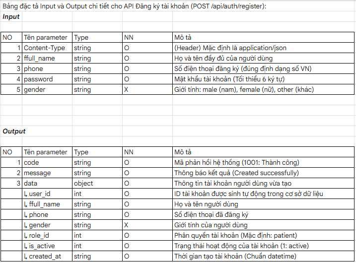

[Liên kết tham chiếu trong PDF, trang 39](https://docs.google.com/spreadsheets/d/162s8pbiP7WhOwSDWopc11hK3Qp-CBYF19qv25ShMKCA/edit?gid=197301990#gid=197301990&range=A1)

#### Mô tả signup

<!-- Trang 40 trong PDF nguồn -->

- API thực hiện việc tạo mới tài khoản bệnh nhân vào hệ thống DrMayDay. Dữ liệu được lưu vào bảng users và thông tin chuyên sâu lưu vào bảng con patients.

- Request dạng POST (/api/v1/auth/signup).

- Tham số (Input): full_name, phone, password, year_of_birth, gender.

- Kết quả đầu ra: Nếu đăng ký thành công thì nhận thông báo thành công và trả về thông tin dữ liệu người dùng. Sẽ báo lỗi nếu thiếu tham số hoặc trùng lặp số điện thoại.

#### Các test case cho signup

<!-- Trang 41 trong PDF nguồn -->

Người dùng nhập đầy đủ thông tin hợp lệ.

- Kết quả mong đợi: Mã 1001 | Created successfully, ứng dụng chuyển sang màn hình Đăng nhập. Người dùng bỏ trống các trường bắt buộc (full_name, phone, password).

- Kết quả mong đợi: Ứng dụng kiểm tra phía client để báo lỗi. Nếu gửi lên server nhận mã lỗi 2001 | Missing required parameter. Người dùng đăng ký bằng số điện thoại đã tồn tại trong hệ thống.

- Kết quả mong đợi: Mã lỗi 3006 | User phone already exists.

#### login

<!-- Trang 43 trong PDF nguồn -->

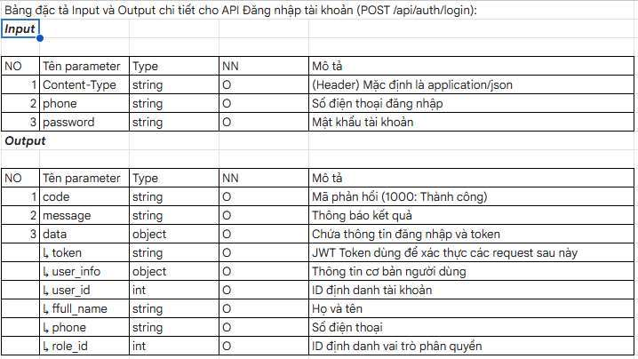

[Liên kết tham chiếu trong PDF, trang 43](https://docs.google.com/spreadsheets/d/162s8pbiP7WhOwSDWopc11hK3Qp-CBYF19qv25ShMKCA/edit?gid=922062722#gid=922062722&range=A1)

#### Mô tả login

<!-- Trang 44 trong PDF nguồn -->

- API thực hiện việc kiểm tra trạng thái hoạt động (is_active) trong bảng users, xác thực mật khẩu và cấp mã phiên làm việc (JWT Token).

- Request dạng POST (/api/v1/auth/login).

- Tham số (Input): phone, password.

- Kết quả đầu ra: Nếu đăng nhập thành công thì hệ thống cấp token và trả về thông tin user. Client lưu cache token và chuyển vào Trang chủ.

#### Các test case cho login

<!-- Trang 45 trong PDF nguồn -->

Người dùng truyền đúng số điện thoại và mật khẩu.

- Kết quả mong đợi: Mã 1000 | OK. Trả về token và object user. Người dùng nhập sai định dạng số điện thoại.

- Kết quả mong đợi: Mã lỗi 2004 | Invalid phone number format. Người dùng nhập sai mật khẩu hoặc số điện thoại chưa được đăng ký.

- Kết quả mong đợi: Mã lỗi 3008 | Password incorrect hoặc mã 3007 | User account not found.

#### logout

<!-- Trang 46 trong PDF nguồn -->

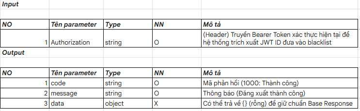

[Liên kết tham chiếu trong PDF, trang 46](https://docs.google.com/spreadsheets/d/162s8pbiP7WhOwSDWopc11hK3Qp-CBYF19qv25ShMKCA/edit?gid=1957178307#gid=1957178307&range=A1)

#### Mô tả logout

<!-- Trang 47 trong PDF nguồn -->

- API thực hiện việc kết thúc phiên làm việc của người dùng trên thiết bị hiện tại.

- Request dạng POST (/api/v1/auth/logout).

- Tham số (Input): Access Token gửi qua Header.

- Kết quả đầu ra: Nhận thông báo "OK". Hệ thống sẽ xóa liên kết thiết bị nhận thông báo đẩy (bảng user_fcm_tokens). Phía Client tự động xóa cache chứa JWT token và chuyển về màn hình đăng nhập.

#### Các test case cho logout

<!-- Trang 48 trong PDF nguồn -->

Người dùng nhấn đăng xuất khi đang có phiên đăng nhập hợp lệ.

- Kết quả mong đợi: Mã 1000 | OK. Ứng dụng xóa token ở client và quay về màn hình khởi động. Người dùng gửi yêu cầu đăng xuất nhưng token không hợp lệ hoặc đã hết hạn.

- Kết quả mong đợi: Mã lỗi 3001 hoặc 3002. Ứng dụng client vẫn tự động dọn sạch dữ liệu phiên cục bộ và ép văng ra màn hình đăng nhập.

#### forgot-password

<!-- Trang 50 trong PDF nguồn -->

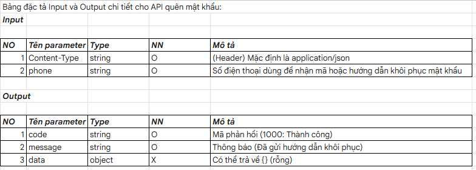

[Liên kết tham chiếu trong PDF, trang 50](https://docs.google.com/spreadsheets/d/162s8pbiP7WhOwSDWopc11hK3Qp-CBYF19qv25ShMKCA/edit?gid=443245942#gid=443245942&range=A1)

#### Mô tả forgot-password

<!-- Trang 51 trong PDF nguồn -->

- API thực hiện việc yêu cầu cấp mã khôi phục tài khoản khi người dùng quên mật khẩu. Hệ thống sẽ tạo mã xác thực và lưu vào cột reset_token (bảng users).

- Request dạng POST (/api/v1/auth/forgot-password).

- Tham số (Input): phone.

- Kết quả đầu ra: Hệ thống báo gửi mã thành công để người dùng tiến hành bước tiếp theo.

#### Các test case cho forgot-password

<!-- Trang 52 trong PDF nguồn -->

Người dùng yêu cầu khôi phục cho số điện thoại hợp lệ.

- Kết quả mong đợi: Mã 1000 | OK. Tin nhắn SMS được gửi đi. Người dùng yêu cầu khôi phục cho số điện thoại không tồn tại.

- Kết quả mong đợi: Mã lỗi 3007 | User account not found.

#### Các test case cho forgot-password

<!-- Trang 53 trong PDF nguồn -->

- Người dùng nhập thiếu các trường bắt buộc (như Họ tên hoặc Mật khẩu). Kết quả mong đợi: Ứng dụng hiện dòng chữ màu đỏ báo lỗi ngay tại client. Nếu gửi lên server nhận mã lỗi 2001 | Missing required parameter.

#### change-password

<!-- Trang 54 trong PDF nguồn -->

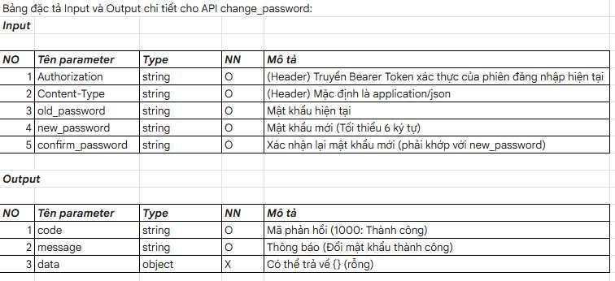

[Liên kết tham chiếu trong PDF, trang 54](https://docs.google.com/spreadsheets/d/162s8pbiP7WhOwSDWopc11hK3Qp-CBYF19qv25ShMKCA/edit?gid=775305043#gid=775305043&range=A1)

#### Mô tả change-password

<!-- Trang 55 trong PDF nguồn -->

- API thực hiện việc cập nhật chuỗi mã hóa mật khẩu mới (password_hash) vào bảng users khi người dùng đang trong phiên đăng nhập hợp lệ.

- Request dạng PUT (/api/v1/auth/change-password).

- Tham số (Input): oldPassword, newPassword, confirm_password (Header cần có Authorization Bearer Token).

- Kết quả đầu ra: Nhận thông báo "OK" và hệ thống ghi nhận mật khẩu mới.

#### Các test case cho change-password

<!-- Trang 56 trong PDF nguồn -->

Người dùng nhập mật khẩu cũ không chính xác.

- Kết quả mong đợi: Mã lỗi 3009 | Old password incorrect. Người dùng nhập mật khẩu xác nhận không khớp với mật khẩu mới.

- Kết quả mong đợi: Mã lỗi 2003 | Invalid parameter value.

#### create-staff

<!-- Trang 58 trong PDF nguồn -->

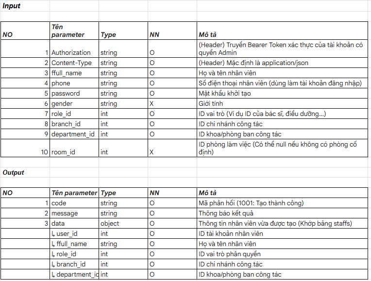

[Liên kết tham chiếu trong PDF, trang 58](https://docs.google.com/spreadsheets/d/162s8pbiP7WhOwSDWopc11hK3Qp-CBYF19qv25ShMKCA/edit?gid=1383375112#gid=1383375112&range=A1)

#### Mô tả create-staff

<!-- Trang 59 trong PDF nguồn -->

- API nội bộ dành cho Admin để tạo tài khoản bác sĩ/nhân viên y tế. Dữ liệu được lưu đồng thời vào bảng users và bảng con staffs (gắn chặt với sơ đồ chi nhánh/khoa/phòng).

- Request dạng POST (/api/v1/auth/admin/create-staff).

- Tham số (Input): full_name, phone, password, role_id, branch_id, department_id, room_id.

#### Các test case cho create-staff

<!-- Trang 60 trong PDF nguồn -->

Người thực hiện API không có quyền Admin.

- Kết quả mong đợi: Mã lỗi 3102 | Admin role required. Gán tài khoản vào Phòng khám (room_id) không thuộc Khoa (department_id) chỉ định.

- Kết quả mong đợi: Mã lỗi 2003 | Invalid parameter value.

#### GET profile

<!-- Trang 62 trong PDF nguồn -->

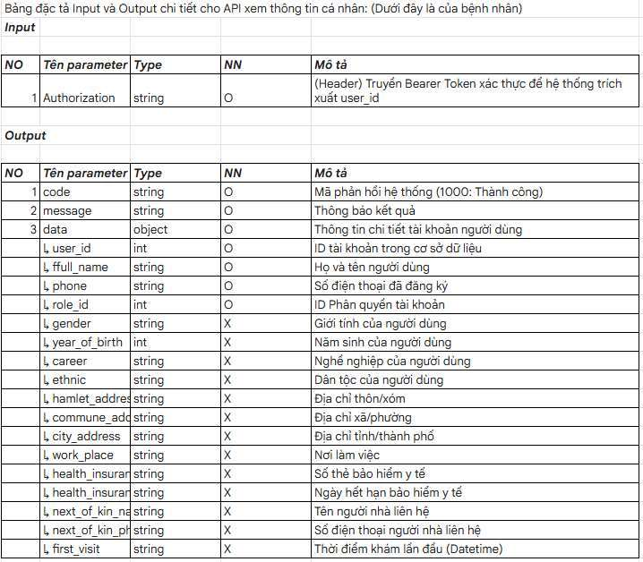

[Liên kết tham chiếu trong PDF, trang 62](https://docs.google.com/spreadsheets/d/162s8pbiP7WhOwSDWopc11hK3Qp-CBYF19qv25ShMKCA/edit?gid=1628595518#gid=1628595518&range=A1)

#### Mô tả GET profile

<!-- Trang 63 trong PDF nguồn -->

- API thực hiện việc truy xuất thông tin hồ sơ chi tiết của bệnh nhân đang đăng nhập. Dữ liệu được kết hợp (JOIN) từ bảng gốc users và bảng chi tiết patients.

- Request dạng GET (/api/v1/profile).

- Tham số (Input): Access Token gửi qua Header.

- Kết quả đầu ra: Trả về toàn bộ dữ liệu hồ sơ cá nhân của bệnh nhân (Bao gồm thông tin liên hệ, nhân khẩu học và bảo hiểm y tế).

#### Các test case cho GET profile

<!-- Trang 64 trong PDF nguồn -->

Bệnh nhân truyền JWT Token hợp lệ.

- Kết quả mong đợi: Mã 1000 | OK. Toàn bộ hồ sơ cá nhân được render lên màn hình. Người dùng không gửi token hoặc token đã hết hạn tự nhiên.

- Kết quả mong đợi: Mã lỗi 3003 | User not authenticated.

#### PUT profile (input)

<!-- Trang 65 trong PDF nguồn -->

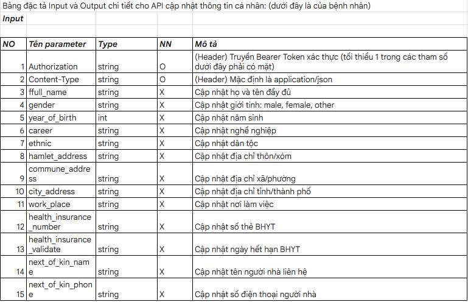

[Liên kết tham chiếu trong PDF, trang 65](https://docs.google.com/spreadsheets/d/162s8pbiP7WhOwSDWopc11hK3Qp-CBYF19qv25ShMKCA/edit?gid=1558026343#gid=1558026343&range=A1)

#### PUT profile (output)

<!-- Trang 66 trong PDF nguồn -->

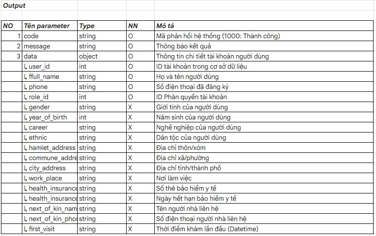

[Liên kết tham chiếu trong PDF, trang 66](https://docs.google.com/spreadsheets/d/162s8pbiP7WhOwSDWopc11hK3Qp-CBYF19qv25ShMKCA/edit?gid=1558026343#gid=1558026343&range=A1)

#### Mô tả PUT profile

<!-- Trang 67 trong PDF nguồn -->

- API cho phép bệnh nhân chủ động cập nhật các thông tin nhân khẩu học (Năm sinh, Giới tính, Nghề nghiệp, Dân tộc), địa chỉ liên hệ và thông tin Bảo hiểm y tế.

- Request dạng PUT (/api/v1/profile).

- Tham số (Input): Dữ liệu cá nhân (Chỉ nhận các trường hợp lệ thuộc bảng users và patients).

- Kết quả đầu ra: Trả về object Profile của bệnh nhân với thông tin vừa được cập nhật mới nhất.

#### Các test case cho PUT profile

<!-- Trang 68 trong PDF nguồn -->

Bệnh nhân chỉnh sửa các trường thông tin và nhấn lưu hợp lệ.

- Kết quả mong đợi: Mã 1000 | OK. Database cập nhật thành công vào bảng users / patients tương ứng và giao diện tải lại dữ liệu mới. Bệnh nhân nhập sai định dạng dữ liệu (VD: year_of_birth chứa ký tự chữ).

- Kết quả mong đợi: Mã lỗi 2002 | Invalid parameter type. Ứng dụng client chặn lại hoặc nhận lỗi từ server hiển thị thông báo đỏ.

###

Phần 2: Quản trị Người dùng, Vai trò & Quyền hạn (Admin Module)

#### Danh sách API

<!-- Trang 71 trong PDF nguồn -->

#### get_list_users(admin02)

<!-- Trang 74 trong PDF nguồn -->

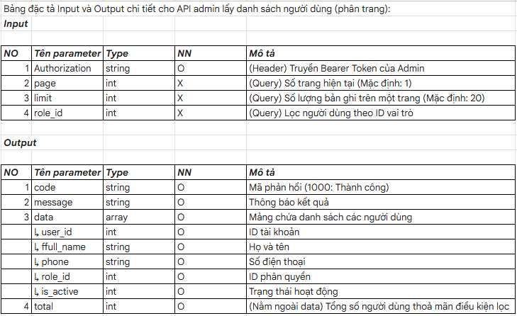

[Liên kết tham chiếu trong PDF, trang 74](https://docs.google.com/spreadsheets/d/162s8pbiP7WhOwSDWopc11hK3Qp-CBYF19qv25ShMKCA/edit?gid=434290707#gid=434290707&range=A1)

#### Mô tả get_list_users

<!-- Trang 75 trong PDF nguồn -->

- Bộ API dùng cho Admin truy xuất danh sách toàn bộ người dùng trong hệ thống (bệnh nhân, bác sĩ, nhân viên) và xem chi tiết một hồ sơ cụ thể.

- Request dạng GET (/api/v1/admin/users và /api/v1/admin/users/:id).

- Kết quả đầu ra: Trả về mảng dữ liệu người dùng (dành cho list) hoặc object chi tiết (dành cho detail). Dữ liệu được kết hợp từ bảng users, patients và staffs.

#### Các test case cho get_list_users

<!-- Trang 76 trong PDF nguồn -->

Admin gọi API với token hợp lệ.

- Kết quả mong đợi: Mã 1000 | OK. Trả về danh sách/chi tiết người dùng kèm metadata phân trang. Admin truy vấn một user :id không tồn tại.

- Kết quả mong đợi: Mã lỗi 3007 | User not found. Tài khoản gọi API không có quyền Quản trị (Admin).

- Kết quả mong đợi: Mã lỗi 3102 | Admin role required. Ứng dụng client hiển thị popup từ chối truy cập.

#### get_user_details(admin03)

<!-- Trang 77 trong PDF nguồn -->

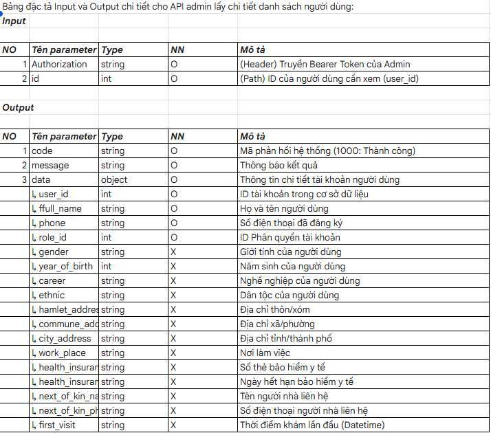

[Liên kết tham chiếu trong PDF, trang 77](https://docs.google.com/spreadsheets/d/162s8pbiP7WhOwSDWopc11hK3Qp-CBYF19qv25ShMKCA/edit?gid=405564125#gid=405564125&range=A1)

#### Mô tả get_user_details

<!-- Trang 78 trong PDF nguồn -->

- Bộ API dùng cho Admin truy xuất danh sách toàn bộ người dùng trong hệ thống (bệnh nhân, bác sĩ, nhân viên) và xem chi tiết một hồ sơ cụ thể.

- Request dạng GET (/api/v1/admin/users và /api/v1/admin/users/:id).

- Kết quả đầu ra: Trả về mảng dữ liệu người dùng (dành cho list) hoặc object chi tiết (dành cho detail). Dữ liệu được kết hợp từ bảng users, patients và staffs.

#### Các test case cho get_user_details

<!-- Trang 79 trong PDF nguồn -->

Admin gọi API với token hợp lệ.

- Kết quả mong đợi: Mã 1000 | OK. Trả về danh sách/chi tiết người dùng kèm metadata phân trang. Admin truy vấn một user :id không tồn tại.

- Kết quả mong đợi: Mã lỗi 3007 | User not found. Tài khoản gọi API không có quyền Quản trị (Admin).

- Kết quả mong đợi: Mã lỗi 3102 | Admin role required. Ứng dụng client hiển thị popup từ chối truy cập.

#### create_user (admin01)

<!-- Trang 81 trong PDF nguồn -->

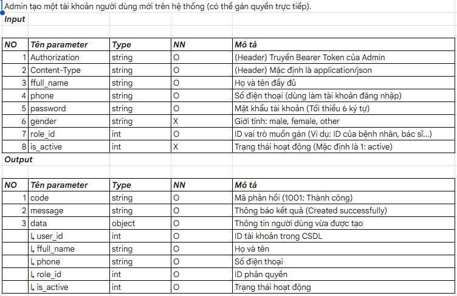

[Liên kết tham chiếu trong PDF, trang 81](https://docs.google.com/spreadsheets/d/162s8pbiP7WhOwSDWopc11hK3Qp-CBYF19qv25ShMKCA/edit?gid=1375876700#gid=1375876700&range=A1)

#### edit_user (admin04)

<!-- Trang 82 trong PDF nguồn -->

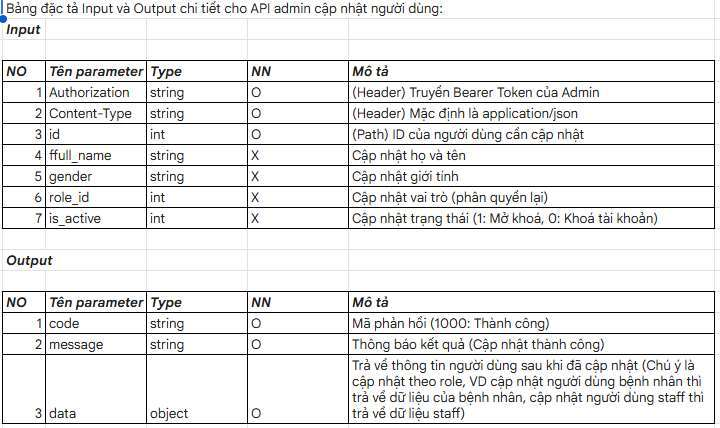

[Liên kết tham chiếu trong PDF, trang 82](https://docs.google.com/spreadsheets/d/162s8pbiP7WhOwSDWopc11hK3Qp-CBYF19qv25ShMKCA/edit?gid=1213763972#gid=1213763972&range=A1)

#### delete_user (admin05)

<!-- Trang 83 trong PDF nguồn -->

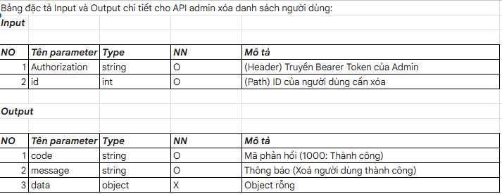

[Liên kết tham chiếu trong PDF, trang 83](https://docs.google.com/spreadsheets/d/162s8pbiP7WhOwSDWopc11hK3Qp-CBYF19qv25ShMKCA/edit?gid=270017767#gid=270017767&range=A1)

#### Mô tả create_user, edit_user, delete_user

<!-- Trang 84 trong PDF nguồn -->

- Nhóm API thực hiện các thao tác Thêm (POST), Sửa (PUT), Xóa (DELETE) người dùng trực tiếp từ Dashboard Admin.

- Thao tác Xóa (DELETE /api/v1/admin/users/:id): Theo thiết kế CSDL, việc xóa user sẽ trigger ON DELETE CASCADE xóa luôn các mã thiết bị FCM (user_fcm_tokens). Tuy nhiên, đối với lịch sử bệnh án (medical_records), cột created_by sẽ được SET NULL để giữ nguyên dữ liệu y tế.

#### Các test case cho create_user, edit_user,

<!-- Trang 85 trong PDF nguồn -->

delete_user (sẽ cập nhật thêm) Admin xóa một bác sĩ đang có lịch sử kê đơn hoặc tạo bệnh án.

- Kết quả mong đợi: Mã 1000 | OK. Bác sĩ bị xóa khỏi bảng users, nhưng hồ sơ bệnh án vẫn được giữ lại với created_by = NULL (Đúng chuẩn thiết kế DB). Admin tạo mới một user nhưng bị trùng số điện thoại.

- Kết quả mong đợi: Mã lỗi 3006 | User phone already exists.

#### assign_user (admin06)

<!-- Trang 87 trong PDF nguồn -->

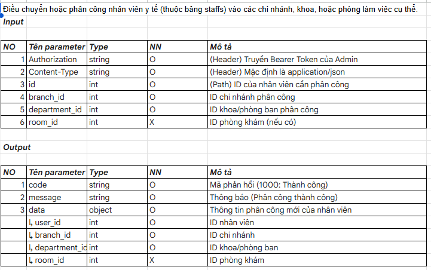

[Liên kết tham chiếu trong PDF, trang 87](https://docs.google.com/spreadsheets/d/162s8pbiP7WhOwSDWopc11hK3Qp-CBYF19qv25ShMKCA/edit?gid=749518053#gid=749518053&range=A1)

#### Mô tả assign_user

<!-- Trang 88 trong PDF nguồn -->

- API thực hiện việc điều chuyển, phân công công tác cho nhân viên y tế vào hệ thống hạ tầng của bệnh viện.

- Request dạng PUT (/api/v1/admin/users/:id/assign).

- Tham số (Input): branch_id, department_id, room_id. Các ID này được cập nhật trực tiếp vào bảng staffs.

- Kết quả đầu ra: Trả về thông tin nhân viên cùng vị trí công tác mới nhất.

#### Các test case cho assign_user

<!-- Trang 89 trong PDF nguồn -->

Admin phân công bác sĩ vào một phòng khám hợp lệ thuộc một khoa.

- Kết quả mong đợi: Mã 1000 | OK. Bảng staffs được cập nhật thành công. Admin gán room_id không trực thuộc department_id đó.

- Kết quả mong đợi: Mã lỗi 2003 | Invalid parameter value.

#### set_role (role01)

<!-- Trang 91 trong PDF nguồn -->

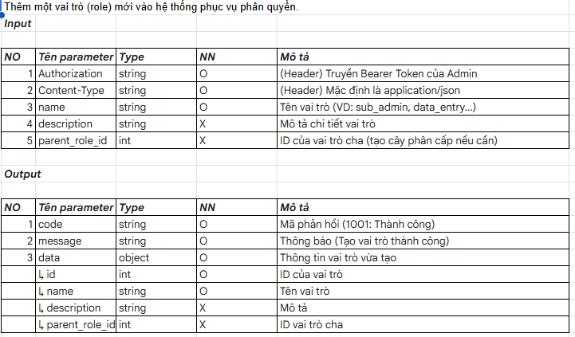

[Liên kết tham chiếu trong PDF, trang 91](https://docs.google.com/spreadsheets/d/162s8pbiP7WhOwSDWopc11hK3Qp-CBYF19qv25ShMKCA/edit?gid=1343149399#gid=1343149399&range=A1)

#### get_role (role02)

<!-- Trang 92 trong PDF nguồn -->

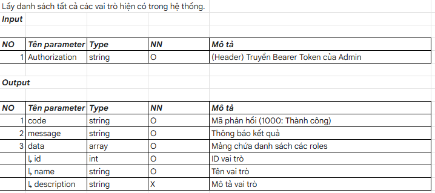

[Liên kết tham chiếu trong PDF, trang 92](https://docs.google.com/spreadsheets/d/162s8pbiP7WhOwSDWopc11hK3Qp-CBYF19qv25ShMKCA/edit?gid=1046807422#gid=1046807422&range=A1)

#### Mô tả set_role, get_role

<!-- Trang 93 trong PDF nguồn -->

- Bộ API định nghĩa các Vai trò trong hệ thống (như Giám đốc, Bác sĩ, Điều dưỡng...). Bảng roles hỗ trợ cấu trúc cây phân cấp thông qua cột tự tham chiếu parent_role_id.

- Request dạng POST và GET tại endpoint /api/v1/roles.

- Kết quả đầu ra: Cho phép Admin xem cấu trúc cây tổ chức và tạo thêm vai trò mới một cách linh hoạt mà không cần sửa code.

#### Các test case cho set_role, get_role

<!-- Trang 94 trong PDF nguồn -->

Admin tạo một vai trò mới (Ví dụ: Thực tập sinh) và gán parent_role_id là Bác sĩ.

- Kết quả mong đợi: Mã 1001 | Created successfully. Role mới được lưu vào hệ thống.

#### set_permission(perm01)

<!-- Trang 96 trong PDF nguồn -->

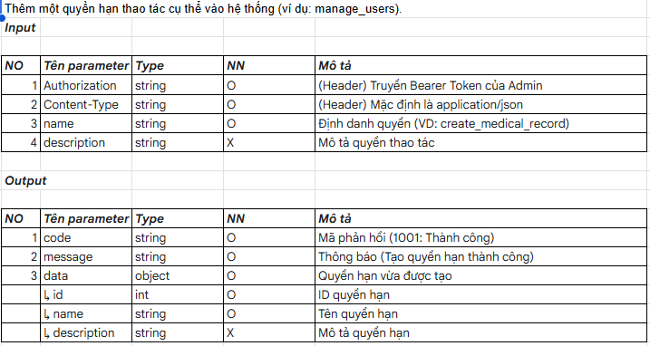

[Liên kết tham chiếu trong PDF, trang 96](https://docs.google.com/spreadsheets/d/162s8pbiP7WhOwSDWopc11hK3Qp-CBYF19qv25ShMKCA/edit?gid=1306309623#gid=1306309623&range=A1)

#### get_list_permissions (perm02)

<!-- Trang 97 trong PDF nguồn -->

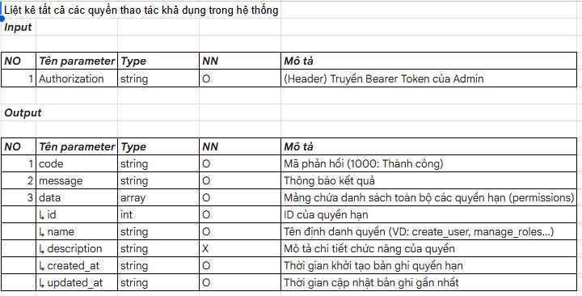

[Liên kết tham chiếu trong PDF, trang 97](https://docs.google.com/spreadsheets/d/162s8pbiP7WhOwSDWopc11hK3Qp-CBYF19qv25ShMKCA/edit?gid=265687709#gid=265687709&range=A1)

#### edit_permission(perm03)

<!-- Trang 98 trong PDF nguồn -->

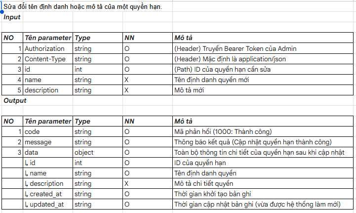

[Liên kết tham chiếu trong PDF, trang 98](https://docs.google.com/spreadsheets/d/162s8pbiP7WhOwSDWopc11hK3Qp-CBYF19qv25ShMKCA/edit?gid=1110223999#gid=1110223999&range=A1)

#### delete_permission(perm04)

<!-- Trang 99 trong PDF nguồn -->

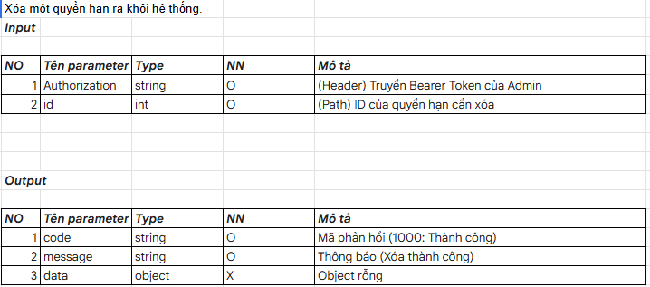

[Liên kết tham chiếu trong PDF, trang 99](https://docs.google.com/spreadsheets/d/162s8pbiP7WhOwSDWopc11hK3Qp-CBYF19qv25ShMKCA/edit?gid=65301139#gid=65301139&range=A1)

#### Mô tả perm01, perm02, perm03, perm04

<!-- Trang 100 trong PDF nguồn -->

- Bộ 4 APIs hỗ trợ Create (POST), Read (GET), Update (PUT), Delete (DELETE) cho bảng permissions. Lưu trữ danh sách các quyền thao tác cụ thể (Ví dụ: manage_users, view_medical_records).

- Endpoint gốc: /api/v1/permissions.

#### Các test case cho change_password

<!-- Trang 101 trong PDF nguồn -->

Admin xóa một quyền (DELETE).

- Kết quả mong đợi: Mã 1000 | OK. Do thiết lập ON DELETE CASCADE ở bảng role_permissions, mọi vai trò đang sở hữu quyền này cũng tự động bị tước quyền tương ứng.

#### set_role_permissions(roleperm01)

<!-- Trang 103 trong PDF nguồn -->

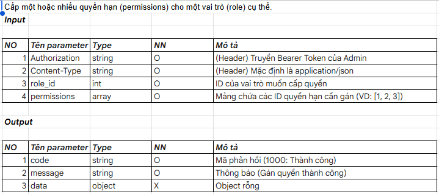

[Liên kết tham chiếu trong PDF, trang 103](https://docs.google.com/spreadsheets/d/162s8pbiP7WhOwSDWopc11hK3Qp-CBYF19qv25ShMKCA/edit?gid=1280999954#gid=1280999954&range=A1)

#### get_role_permissions(roleperm02)

<!-- Trang 104 trong PDF nguồn -->

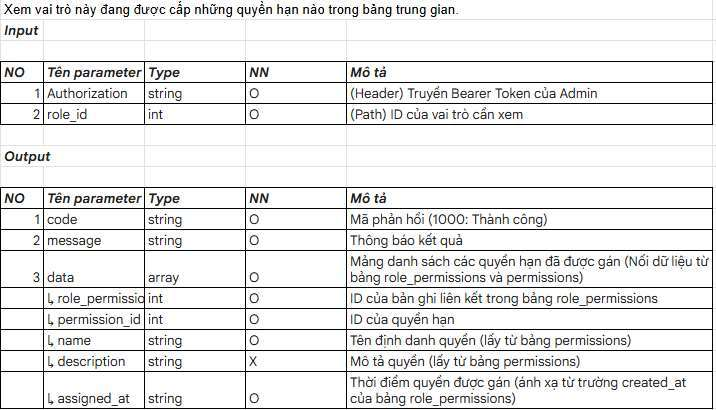

[Liên kết tham chiếu trong PDF, trang 104](https://docs.google.com/spreadsheets/d/162s8pbiP7WhOwSDWopc11hK3Qp-CBYF19qv25ShMKCA/edit?gid=505062392#gid=505062392&range=A1)

#### delete_role_permissions(roleperm03)

<!-- Trang 105 trong PDF nguồn -->

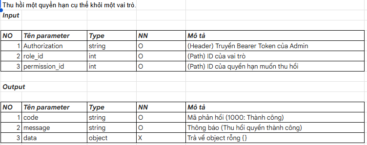

[Liên kết tham chiếu trong PDF, trang 105](https://docs.google.com/spreadsheets/d/162s8pbiP7WhOwSDWopc11hK3Qp-CBYF19qv25ShMKCA/edit?gid=309728789#gid=309728789&range=A1)

#### Mô tả roleperm01, roleperm02, roleperm03

<!-- Trang 106 trong PDF nguồn -->

- Nhóm API thực hiện cơ chế RBAC (Role-Based Access Control) bằng cách map các quyền vào vai trò thông qua bảng trung gian N-N role_permissions.

- Request hỗ trợ POST (Cấp quyền), GET (Lấy danh sách quyền của 1 role), và DELETE (Tước quyền).

- Endpoint: /api/v1/role_permissions....

#### Các test case cho roleperm01, roleperm02, roleperm03

<!-- Trang 107 trong PDF nguồn -->

Admin cấp một mảng các permission_id hợp lệ cho một role_id.

- Kết quả mong đợi: Mã 1000 | OK. DB ghi nhận các dòng mới vào bảng role_permissions. Admin cấp một quyền đã tồn tại sẵn trong vai trò đó.

- Kết quả mong đợi: Server bỏ qua (không báo lỗi do xử lý logic chống trùng) hoặc trả mã 2003 tùy cấu hình, không gây lỗi DB.

###

Phần 3: Quản lý Cơ sở vật chất & Hạ tầng tổ chức (Topology)

#### Danh sách API

<!-- Trang 110 trong PDF nguồn -->

#### set_branch (branch01)

<!-- Trang 113 trong PDF nguồn -->

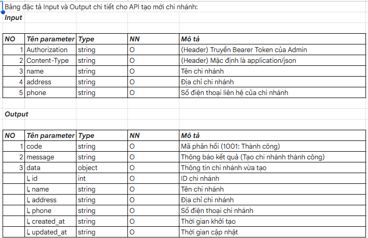

[Liên kết tham chiếu trong PDF, trang 113](https://docs.google.com/spreadsheets/d/162s8pbiP7WhOwSDWopc11hK3Qp-CBYF19qv25ShMKCA/edit?gid=129692367#gid=129692367&range=A1)

#### get_list_branches (branch02)

<!-- Trang 114 trong PDF nguồn -->

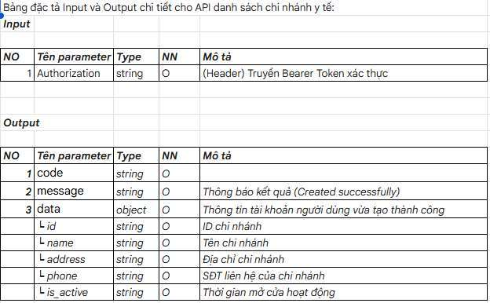

[Liên kết tham chiếu trong PDF, trang 114](https://docs.google.com/spreadsheets/d/162s8pbiP7WhOwSDWopc11hK3Qp-CBYF19qv25ShMKCA/edit?gid=2135180545#gid=2135180545&range=A1)

#### get_branch_detail (branch03)

<!-- Trang 115 trong PDF nguồn -->

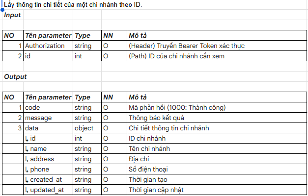

[Liên kết tham chiếu trong PDF, trang 115](https://docs.google.com/spreadsheets/d/162s8pbiP7WhOwSDWopc11hK3Qp-CBYF19qv25ShMKCA/edit?gid=529141971#gid=529141971&range=A1)

#### edit_branch (branch04)

<!-- Trang 116 trong PDF nguồn -->

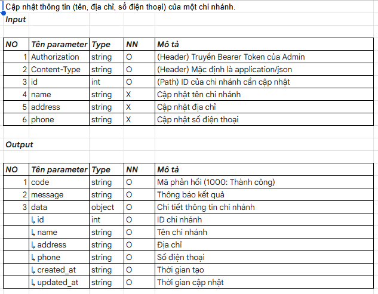

[Liên kết tham chiếu trong PDF, trang 116](https://docs.google.com/spreadsheets/d/162s8pbiP7WhOwSDWopc11hK3Qp-CBYF19qv25ShMKCA/edit?gid=1280951284#gid=1280951284&range=A1)

#### delete_branch (branch05)

<!-- Trang 117 trong PDF nguồn -->

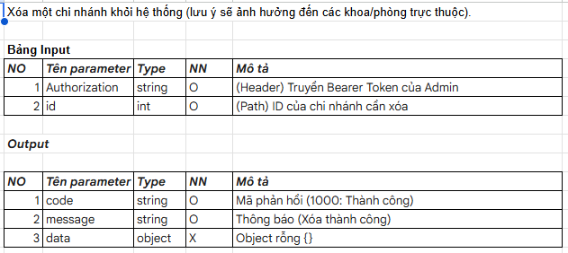

[Liên kết tham chiếu trong PDF, trang 117](https://docs.google.com/spreadsheets/d/162s8pbiP7WhOwSDWopc11hK3Qp-CBYF19qv25ShMKCA/edit?gid=1730400135#gid=1730400135&range=A1)

#### Mô tả branch01, branch02, branch03, branch04, branch05

<!-- Trang 118 trong PDF nguồn -->

Nhóm 5 API (set, get_list, get_detail, edit, delete) dùng để quản lý cấp cao nhất của sơ đồ tổ chức: Chi nhánh/Cơ sở y tế thuộc hệ thống bệnh viện đa chi nhánh.

Endpoints: /api/v1/branches... hỗ trợ các method POST, GET, PUT, DELETE tương ứng.

Dữ liệu được lưu trữ trực tiếp vào bảng branches.

#### Các test case cho branch01, branch02, branch03, branch04, branch05

<!-- Trang 119 trong PDF nguồn -->

Admin tạo mới một chi nhánh hợp lệ.

- Kết quả mong đợi: Mã 1001 | Created successfully. Dữ liệu lưu vào DB và trả về object chi nhánh. Admin thực hiện xóa (DELETE) một chi nhánh ĐANG CÓ khoa/phòng ban trực thuộc hoặc đang có nhân viên làm việc (users.branch_id).

- Kết quả mong đợi: Database chặn lệnh xóa thông qua cơ chế khóa ngoại RESTRICT. Hệ thống trả về mã lỗi 2003 | Invalid parameter value hoặc lỗi SQL (không thể xóa do tồn tại dữ liệu con).

#### set_department(dept01)

<!-- Trang 121 trong PDF nguồn -->

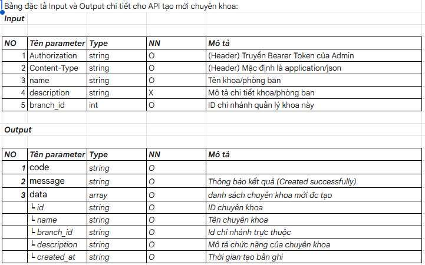

[Liên kết tham chiếu trong PDF, trang 121](https://docs.google.com/spreadsheets/d/162s8pbiP7WhOwSDWopc11hK3Qp-CBYF19qv25ShMKCA/edit?gid=2031529956#gid=2031529956&range=A1)

#### get_list_departments(dept02)

<!-- Trang 122 trong PDF nguồn -->

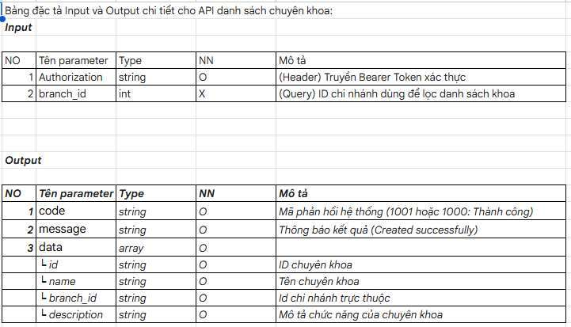

[Liên kết tham chiếu trong PDF, trang 122](https://docs.google.com/spreadsheets/d/162s8pbiP7WhOwSDWopc11hK3Qp-CBYF19qv25ShMKCA/edit?gid=198903998#gid=198903998&range=A1)

#### get_department_detail(dept03)

<!-- Trang 123 trong PDF nguồn -->

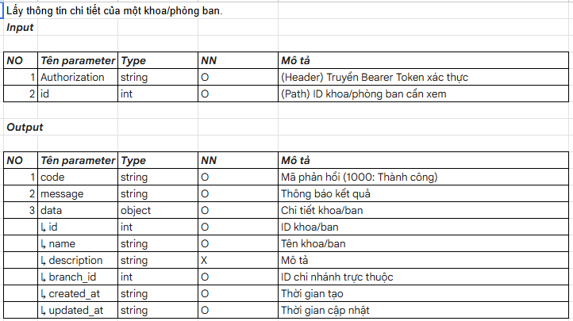

[Liên kết tham chiếu trong PDF, trang 123](https://docs.google.com/spreadsheets/d/162s8pbiP7WhOwSDWopc11hK3Qp-CBYF19qv25ShMKCA/edit?gid=430303803#gid=430303803&range=A1)

#### edit_department(dept04)

<!-- Trang 124 trong PDF nguồn -->

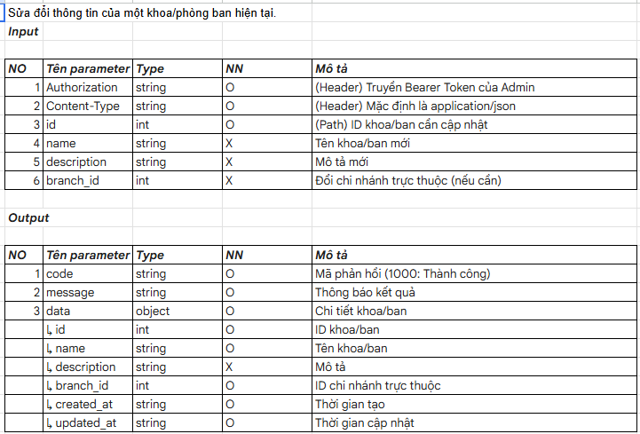

[Liên kết tham chiếu trong PDF, trang 124](https://docs.google.com/spreadsheets/d/162s8pbiP7WhOwSDWopc11hK3Qp-CBYF19qv25ShMKCA/edit?gid=2068560555#gid=2068560555&range=A1)

#### delete_department(dept05)

<!-- Trang 125 trong PDF nguồn -->

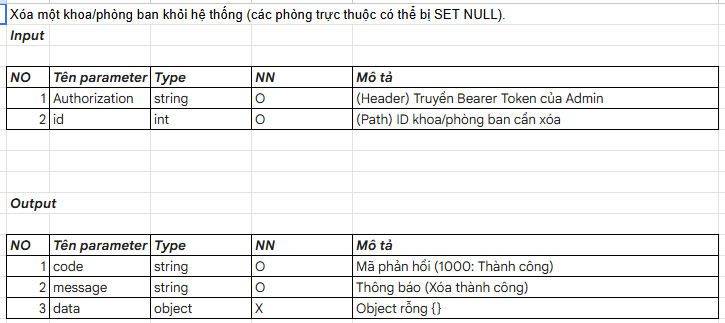

[Liên kết tham chiếu trong PDF, trang 125](https://docs.google.com/spreadsheets/d/162s8pbiP7WhOwSDWopc11hK3Qp-CBYF19qv25ShMKCA/edit?gid=871748420#gid=871748420&range=A1)

#### Mô tả dept01, dept02, dept03, dept04, dept05

<!-- Trang 126 trong PDF nguồn -->

- Nhóm 5 API thực hiện quản lý các Khoa chuyên môn (Ví dụ: Khoa Da liễu, Khoa Xét nghiệm). Đây là tầng thứ 2 trong cây phân cấp, bắt buộc phải trực thuộc một Chi nhánh (branch_id).

- Endpoints: /api/v1/departments....

- Tính toàn vẹn: Khi một Khoa bị xóa (DELETE), theo thiết kế DB, các Phòng khám trực thuộc Khoa đó (rooms.department_id) sẽ được tự động cập nhật về NULL (ON DELETE SET NULL) thay vì bị xóa mất.

#### Các test case cho dept01, dept02, dept03, dept04, dept05

<!-- Trang 127 trong PDF nguồn -->

Admin tạo mới một Khoa nhưng truyền branch_id (Chi nhánh) không tồn tại.

- Kết quả mong đợi: Mã lỗi 2003 | Invalid parameter value do vi phạm khóa ngoại. Admin xóa thành công một Khoa đang có 5 Phòng khám trực thuộc.

- Kết quả mong đợi: Mã 1000 | OK. 5 Phòng khám kia vẫn tồn tại trong DB nhưng department_id chuyển thành NULL.

#### set_room (room01)

<!-- Trang 129 trong PDF nguồn -->

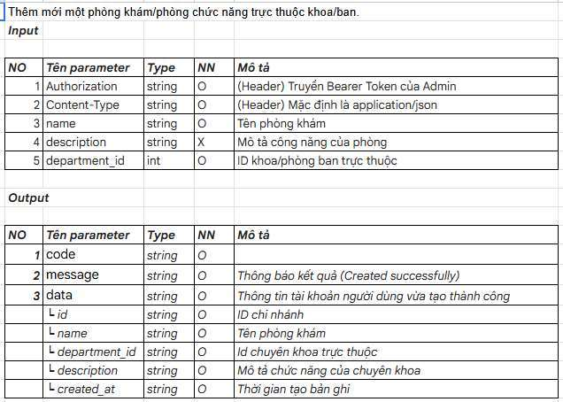

[Liên kết tham chiếu trong PDF, trang 129](https://docs.google.com/spreadsheets/d/162s8pbiP7WhOwSDWopc11hK3Qp-CBYF19qv25ShMKCA/edit?gid=1410087729#gid=1410087729&range=A1)

#### get_list_rooms (room02)

<!-- Trang 130 trong PDF nguồn -->

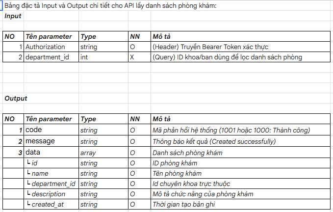

[Liên kết tham chiếu trong PDF, trang 130](https://docs.google.com/spreadsheets/d/162s8pbiP7WhOwSDWopc11hK3Qp-CBYF19qv25ShMKCA/edit?gid=535072778#gid=535072778&range=A1)

#### get_room_detail (room03)

<!-- Trang 131 trong PDF nguồn -->

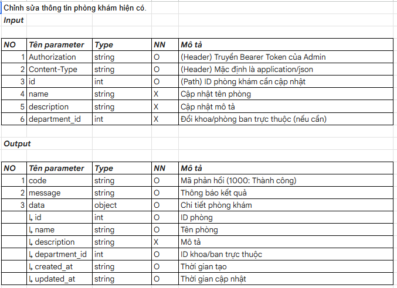

[Liên kết tham chiếu trong PDF, trang 131](https://docs.google.com/spreadsheets/d/162s8pbiP7WhOwSDWopc11hK3Qp-CBYF19qv25ShMKCA/edit?gid=1380597674#gid=1380597674&range=A1)

#### edit_room (room04)

<!-- Trang 132 trong PDF nguồn -->

[Liên kết tham chiếu trong PDF, trang 132](https://docs.google.com/spreadsheets/d/162s8pbiP7WhOwSDWopc11hK3Qp-CBYF19qv25ShMKCA/edit?gid=647176388#gid=647176388&range=A1)

#### delete_room (room05)

<!-- Trang 133 trong PDF nguồn -->

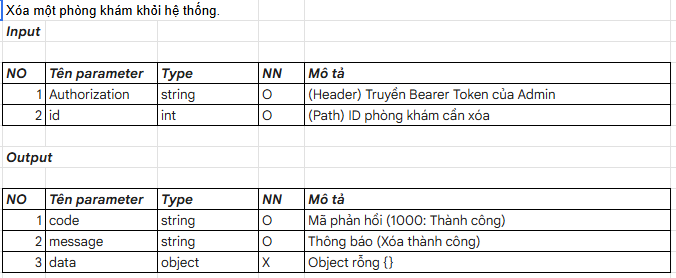

[Liên kết tham chiếu trong PDF, trang 133](https://docs.google.com/spreadsheets/d/162s8pbiP7WhOwSDWopc11hK3Qp-CBYF19qv25ShMKCA/edit?gid=275069272#gid=275069272&range=A1)

#### Mô tả room01, room02, room03, room04, room05

<!-- Trang 134 trong PDF nguồn -->

- Nhóm 5 API quản lý các phòng khám, phòng chức năng cụ thể. Đây là đơn vị nhỏ nhất trong sơ đồ tổ chức vật lý, dùng để bố trí nhân sự (staffs) làm việc.

- Endpoints: /api/v1/rooms....

- Tính toàn vẹn: Dữ liệu được quản lý chặt chẽ trong bảng rooms. Việc xóa phòng khám chịu sự kiểm soát RESTRICT nếu đang có nhân sự thuộc phòng đó.

#### Các test case cho room01, room02, room03, room04, room05

<!-- Trang 135 trong PDF nguồn -->

Admin gán một Phòng khám mới trực thuộc một Khoa hợp lệ (department_id).

- Kết quả mong đợi: Mã 1001 | Created successfully. Admin cố gắng xóa một Phòng khám vẫn đang có bác sĩ (staffs) được phân công làm việc (users.room_id).

- Kết quả mong đợi: Khóa ngoại RESTRICT chặn việc xóa. Trả về mã lỗi báo không thể xóa phòng đang hoạt động.

###

Phần 4: Quản lý Bệnh nhân và Hồ sơ Bệnh án (Medical Records)

#### Danh sách API

<!-- Trang 138 trong PDF nguồn -->

#### search_patients (docpat01)

<!-- Trang 141 trong PDF nguồn -->

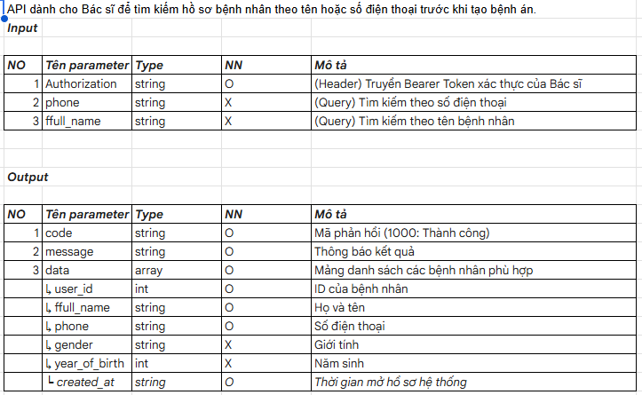

[Liên kết tham chiếu trong PDF, trang 141](https://docs.google.com/spreadsheets/d/162s8pbiP7WhOwSDWopc11hK3Qp-CBYF19qv25ShMKCA/edit?gid=1200680805#gid=1200680805&range=A1)

#### Mô tả docpat01

<!-- Trang 142 trong PDF nguồn -->

- API hỗ trợ Bác sĩ/Nhân viên y tế tìm kiếm hồ sơ bệnh nhân hiện có trong hệ thống trước khi khám.

- Request dạng GET (/api/v1/doctor/patients/search).

- Backend chú ý: Thực hiện query LIKE trên bảng users (đã JOIN với patients) dựa trên phone hoặc full_name.

- Kết quả đầu ra: Trả về danh sách bệnh nhân phù hợp.

#### Các test case cho docpat01

<!-- Trang 143 trong PDF nguồn -->

Bác sĩ tìm kiếm bằng số điện thoại hợp lệ.

- Kết quả mong đợi: Mã 1000 | OK. Trả về mảng dữ liệu bệnh nhân. Người dùng không có quyền Bác sĩ gọi API.

- Kết quả mong đợi: Mã lỗi 3103 | Doctor role required.

#### create_patient (docpat02) (input)

<!-- Trang 144 trong PDF nguồn -->

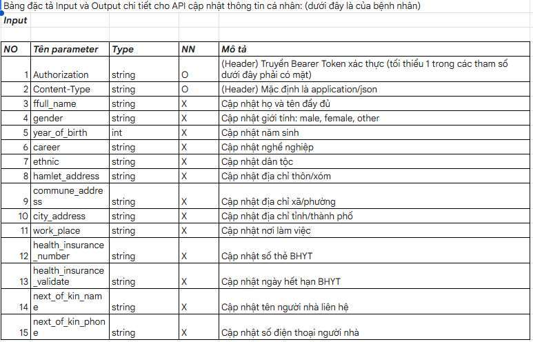

[Liên kết tham chiếu trong PDF, trang 144](https://docs.google.com/spreadsheets/d/162s8pbiP7WhOwSDWopc11hK3Qp-CBYF19qv25ShMKCA/edit?gid=298841007#gid=298841007&range=A1)

#### create_patient (docpat02) (output)

<!-- Trang 145 trong PDF nguồn -->

[Liên kết tham chiếu trong PDF, trang 145](https://docs.google.com/spreadsheets/d/162s8pbiP7WhOwSDWopc11hK3Qp-CBYF19qv25ShMKCA/edit?gid=298841007#gid=298841007&range=A1)

#### Mô tả docpat02

<!-- Trang 146 trong PDF nguồn -->

- API cho phép Bác sĩ/Lễ tân chủ động tạo tài khoản cho bệnh nhân mới đến khám trực tiếp tại viện.

- Request dạng POST (/api/v1/doctor/patients/).

- Backend chú ý: Lưu dữ liệu vào bảng users (với role_id là patient) và bảng con patients. Trạng thái is_active mặc định = 1.

#### Các test case cho docpat02

<!-- Trang 147 trong PDF nguồn -->

Bác sĩ tạo bệnh nhân với thông tin đầy đủ.

- Kết quả mong đợi: Mã 1001 | Created successfully. Số điện thoại bệnh nhân đã có sẵn trong hệ thống.

- Kết quả mong đợi: Mã lỗi 3006 | User phone already exists.

#### get_medicalrecords_classifyquestions (medrec01)

<!-- Trang 149 trong PDF nguồn -->

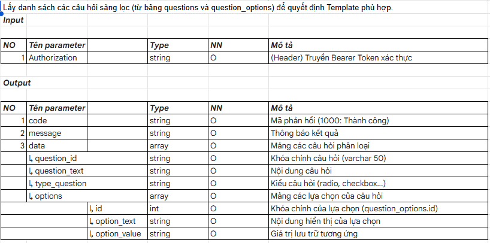

[Liên kết tham chiếu trong PDF, trang 149](https://docs.google.com/spreadsheets/d/162s8pbiP7WhOwSDWopc11hK3Qp-CBYF19qv25ShMKCA/edit?gid=839267768#gid=839267768&range=A1)

#### Mô tả medrec01

<!-- Trang 150 trong PDF nguồn -->

- API lấy danh sách các câu hỏi sơ bộ (có từng khám chưa, có mắc bệnh mãn tính không...) để hệ thống quyết định dùng Mẫu phiếu khám (Template) nào.

- Request dạng GET (/api/v1/medical_records/classify-questions).

- Kết quả đầu ra: Trả về mảng các câu hỏi phân loại.

#### Các test case cho medrec01

<!-- Trang 151 trong PDF nguồn -->

Gọi API thành công.

- Kết quả mong đợi: Mã 1000 | OK. Trả về danh sách câu hỏi phân loại.

#### set_medicalrecords_classify (medrec02)

<!-- Trang 152 trong PDF nguồn -->

[Liên kết tham chiếu trong PDF, trang 152](https://docs.google.com/spreadsheets/d/162s8pbiP7WhOwSDWopc11hK3Qp-CBYF19qv25ShMKCA/edit?gid=1499318100#gid=1499318100&range=A1)

#### Mô tả medrec02

<!-- Trang 153 trong PDF nguồn -->

- API tiếp nhận câu trả lời phân loại và mapping với logic nội bộ để trả về template_id chính xác nhất cho bệnh án chuẩn bị khởi tạo.

- Request dạng POST (/api/v1/medical_records/classify).

- Kết quả đầu ra: Trả về template_id (Ví dụ: TMPL_URT_CHRONIC) và cấu trúc của template đó.

#### Các test case cho medrec02

<!-- Trang 154 trong PDF nguồn -->

Trả lời đầy đủ các câu hỏi phân loại.

- Kết quả mong đợi: Mã 1000 | OK kèm thông tin template_id. Truyền thiếu lựa chọn phân loại.

- Kết quả mong đợi: Mã lỗi 4006 | Classification options incomplete.

#### set_medicalrecords_create(medrec03) (input)

<!-- Trang 155 trong PDF nguồn -->

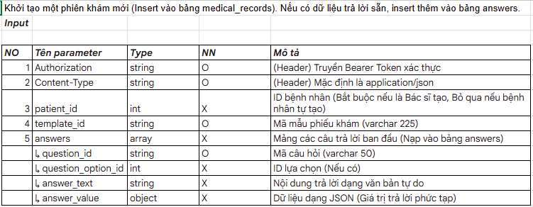

[Liên kết tham chiếu trong PDF, trang 155](https://docs.google.com/spreadsheets/d/162s8pbiP7WhOwSDWopc11hK3Qp-CBYF19qv25ShMKCA/edit?gid=1254044733#gid=1254044733&range=A1)

#### set_medicalrecords_create(medrec03) (output)

<!-- Trang 156 trong PDF nguồn -->

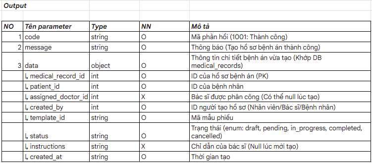

[Liên kết tham chiếu trong PDF, trang 156](https://docs.google.com/spreadsheets/d/162s8pbiP7WhOwSDWopc11hK3Qp-CBYF19qv25ShMKCA/edit?gid=1254044733#gid=1254044733&range=A1)

#### Mô tả medrec03

<!-- Trang 157 trong PDF nguồn -->

- API Khởi tạo một hồ sơ bệnh án mới.

- Request dạng POST (/api/v1/medical_records/).

- Backend chú ý: Khởi tạo record trong bảng medical_records. Set patient_id = ID người dùng, template_id = template được chọn. Trạng thái status khởi tạo là pending (đang chờ bác sĩ nhận). Nếu người tạo là bác sĩ thì created_by = ID bác sĩ.

#### Các test case cho medrec03

<!-- Trang 158 trong PDF nguồn -->

Tạo bệnh án với template hợp lệ.

- Kết quả mong đợi: Mã 1001 | Created successfully. Trả về medical_record_id. Truyền một template_id không tồn tại.

- Kết quả mong đợi: Mã lỗi 4101 | Template not found.

#### get_medicalrecords_all(medrec04)

<!-- Trang 160 trong PDF nguồn -->

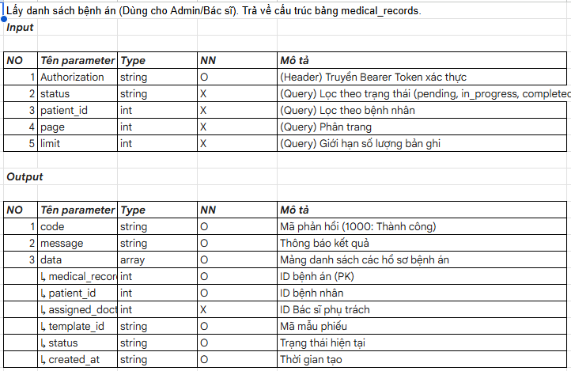

[Liên kết tham chiếu trong PDF, trang 160](https://docs.google.com/spreadsheets/d/162s8pbiP7WhOwSDWopc11hK3Qp-CBYF19qv25ShMKCA/edit?gid=1050343001#gid=1050343001&range=A1)

#### Mô tả medrec04

<!-- Trang 161 trong PDF nguồn -->

- API dành cho Bác sĩ/Lễ tân lấy danh sách toàn bộ hồ sơ bệnh án trong viện để điều phối.

- Request dạng GET (/api/v1/medical_records/all).

- Backend chú ý: Cần hỗ trợ query param status (pending, in_progress, completed) để UI lọc danh sách.

#### Các test case cho medrec04

<!-- Trang 162 trong PDF nguồn -->

Gọi API với quyền Bác sĩ và filter status = pending.

- Kết quả mong đợi: Mã 1000 | OK. Trả về mảng các bệnh án đang chờ tiếp nhận.

#### get_medicalrecords_id(medrec05)

<!-- Trang 163 trong PDF nguồn -->

[Liên kết tham chiếu trong PDF, trang 163](https://docs.google.com/spreadsheets/d/162s8pbiP7WhOwSDWopc11hK3Qp-CBYF19qv25ShMKCA/edit?gid=544052006#gid=544052006&range=A1)

#### Mô tả medrec05

<!-- Trang 164 trong PDF nguồn -->

- API xem chi tiết tổng quan của 1 bệnh án cụ thể.

- Request dạng GET (/api/v1/medical_records/:id).

- Backend chú ý: Lấy thông tin từ bảng medical_records, kèm thông tin patient_id, assigned_doctor_id và created_by.

#### Các test case cho medrec05

<!-- Trang 165 trong PDF nguồn -->

Truyền ID bệnh án tồn tại.

- Kết quả mong đợi: Mã 1000 | OK. Truyền ID bệnh án không có trong hệ thống.

- Kết quả mong đợi: Mã lỗi 4001 | Medical record not found.

#### get_medicalrecords_summary(medrec06)

<!-- Trang 166 trong PDF nguồn -->

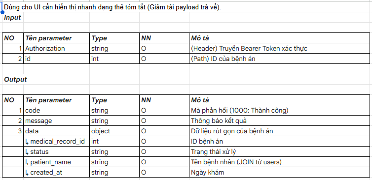

[Liên kết tham chiếu trong PDF, trang 166](https://docs.google.com/spreadsheets/d/162s8pbiP7WhOwSDWopc11hK3Qp-CBYF19qv25ShMKCA/edit?gid=312161648#gid=312161648&range=A1)

#### Mô tả medrec06

<!-- Trang 167 trong PDF nguồn -->

- API cung cấp một bản tóm tắt nhanh (Summary) của bệnh án, dùng để hiển thị trên UI dạng thẻ (Card) hoặc header.

- Request dạng GET (/api/v1/medical_records/:id/summary)

#### Các test case cho medrec06

<!-- Trang 168 trong PDF nguồn -->

Gọi API xem tóm tắt.

- Kết quả mong đợi: Mã 1000 | OK. Trả về thông tin tóm gọn (Status, ngày tạo, tên bệnh nhân).

#### get_history_medicalrecords(medrec13)

<!-- Trang 169 trong PDF nguồn -->

[Liên kết tham chiếu trong PDF, trang 169](https://docs.google.com/spreadsheets/d/162s8pbiP7WhOwSDWopc11hK3Qp-CBYF19qv25ShMKCA/edit?gid=1722132503#gid=1722132503&range=A1)

#### Mô tả medrec13

<!-- Trang 170 trong PDF nguồn -->

- API truy xuất toàn bộ lịch sử khám bệnh (các bệnh án cũ) của một bệnh nhân cụ thể.

- Request dạng GET (/api/v1/medical_records/patients/:id/history).

- Backend chú ý: Query bảng medical_records where patient_id = :id, sort theo created_at DESC.

#### Các test case cho medrec13

<!-- Trang 171 trong PDF nguồn -->

Bác sĩ hoặc chính bệnh nhân đó gọi API.

- Kết quả mong đợi: Mã 1000 | OK. Trả về mảng lịch sử. Bệnh nhân A cố tình truyền ID của Bệnh nhân B.

- Kết quả mong đợi: Mã lỗi 3106 | Cannot access another user's data (RBAC chặn).

#### set_accept_medicalrecords(medrec07)

<!-- Trang 173 trong PDF nguồn -->

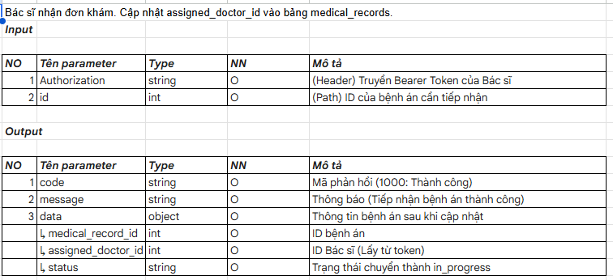

[Liên kết tham chiếu trong PDF, trang 173](https://docs.google.com/spreadsheets/d/162s8pbiP7WhOwSDWopc11hK3Qp-CBYF19qv25ShMKCA/edit?gid=1452024462#gid=1452024462&range=A1)

#### Mô tả medrec07

<!-- Trang 174 trong PDF nguồn -->

- API để Bác sĩ "nhận ca" khám.

- Request dạng POST (/api/v1/medical_records/:id/accept).

- Backend chú ý: Cập nhật cột assigned_doctor_id = ID của bác sĩ gọi API. Đổi status từ pending sang in_progress.

#### Các test case cho medrec07

<!-- Trang 175 trong PDF nguồn -->

Bác sĩ tiếp nhận bệnh án đang ở trạng thái pending.

- Kết quả mong đợi: Mã 1000 | OK. Bệnh án đã được bác sĩ khác nhận (status = in_progress).

- Kết quả mong đợi: Mã lỗi 4005 | Already accepted by another doctor. Bệnh án không ở trạng thái pending.

- Kết quả mong đợi: Mã lỗi 4004 | Medical record not in pending status.

#### credit_medicalrecords(medrec11)

<!-- Trang 176 trong PDF nguồn -->

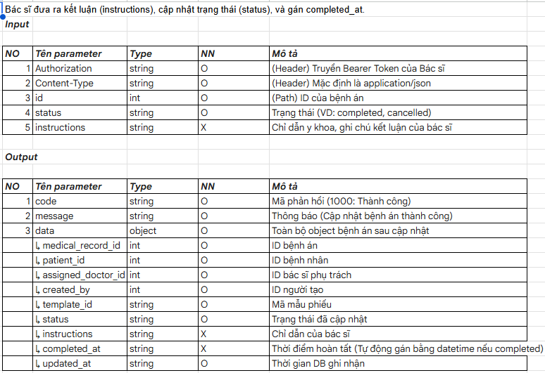

[Liên kết tham chiếu trong PDF, trang 176](https://docs.google.com/spreadsheets/d/162s8pbiP7WhOwSDWopc11hK3Qp-CBYF19qv25ShMKCA/edit?gid=1748265966#gid=1748265966&range=A1)

#### Mô tả medrec11

<!-- Trang 177 trong PDF nguồn -->

- API thực hiện việc "Chốt bệnh án".

- Request dạng PUT (/api/v1/medical_records/:id).

- Backend chú ý: API này cập nhật text instructions (chỉ dẫn của bác sĩ) vào bảng medical_records. Đồng thời chuyển trạng thái status thành completed và ghi nhận timestamp vào cột completed_at.

#### Các test case cho medrec11

<!-- Trang 178 trong PDF nguồn -->

Bác sĩ phụ trách gọi API chốt hồ sơ.

- Kết quả mong đợi: Mã 1000 | OK. Hồ sơ khóa thành công. Một bác sĩ khác (không phải assigned_doctor_id) gọi API.

- Kết quả mong đợi: Mã lỗi 3105 | Doctor not assigned to this record.

#### get_medicalrecords_answers(medrec08)

<!-- Trang 180 trong PDF nguồn -->

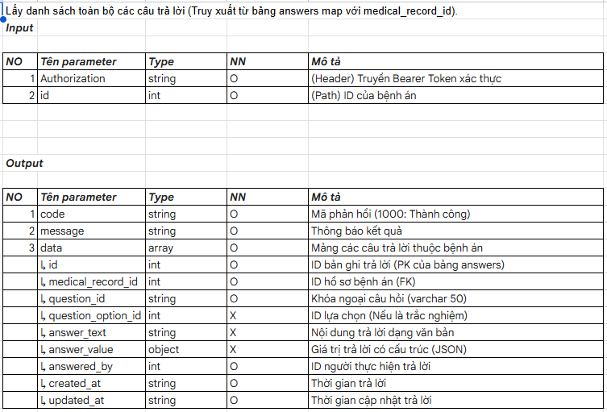

[Liên kết tham chiếu trong PDF, trang 180](https://docs.google.com/spreadsheets/d/162s8pbiP7WhOwSDWopc11hK3Qp-CBYF19qv25ShMKCA/edit?gid=1276019672#gid=1276019672&range=A1)

#### Mô tả medrec08

<!-- Trang 181 trong PDF nguồn -->

- API truy xuất toàn bộ câu trả lời chi tiết trong biểu mẫu khám của bệnh án.

- Request dạng GET (/api/v1/medical_records/:id/answers).

- Backend chú ý: JOIN bảng answers dựa trên medical_record_id. Trả về danh sách mapping question_id và answer_value / answer_text.

#### Các test case cho medrec08

<!-- Trang 182 trong PDF nguồn -->

Gọi API với bệnh án hợp lệ.

- Kết quả mong đợi: Mã 1000 | OK. Trả về mảng câu trả lời.

#### update_medicalrecords_answers (medrec10)

<!-- Trang 183 trong PDF nguồn -->

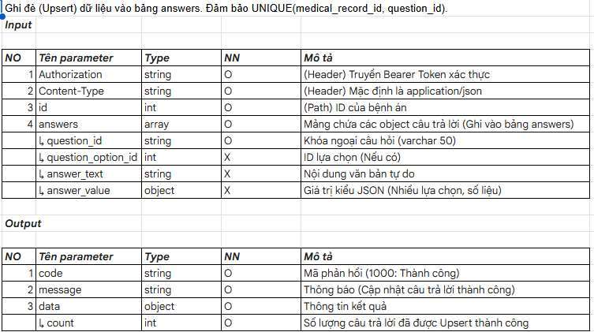

[Liên kết tham chiếu trong PDF, trang 183](https://docs.google.com/spreadsheets/d/162s8pbiP7WhOwSDWopc11hK3Qp-CBYF19qv25ShMKCA/edit?gid=147827662#gid=147827662&range=A1)

#### Mô tả medrec10

<!-- Trang 184 trong PDF nguồn -->

- API cho phép Bệnh nhân (trước khi khám) hoặc Bác sĩ (đang khám) cập nhật lại câu trả lời trong phiếu.

- Request dạng PUT (/api/v1/medical_records/:id/answers).

- Backend chú ý: Xử lý theo luật UNIQUE(medical_record_id, question_id). Nếu sửa thì update bản ghi hiện tại trong bảng answers.

#### Các test case cho medrec10

<!-- Trang 185 trong PDF nguồn -->

Cập nhật câu trả lời khi bệnh án đang in_progress.

- Kết quả mong đợi: Mã 1000 | OK. Cố tình cập nhật khi bệnh án đã đóng (status = completed).

- Kết quả mong đợi: Mã lỗi 4003 | Medical record already completed.

#### delete_medicalrecords(medrec14)

<!-- Trang 186 trong PDF nguồn -->

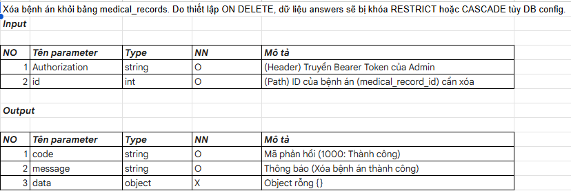

[Liên kết tham chiếu trong PDF, trang 186](https://docs.google.com/spreadsheets/d/162s8pbiP7WhOwSDWopc11hK3Qp-CBYF19qv25ShMKCA/edit?gid=1888610589#gid=1888610589&range=A1)

#### Mô tả medrec14

<!-- Trang 187 trong PDF nguồn -->

- API thực hiện xóa toàn bộ hồ sơ bệnh án (Dành riêng cho Admin).

- Request dạng DELETE (/api/v1/medical_records/:id/).

- Backend chú ý: Khi xóa record trong medical_records, các bản ghi con trong bảng answers phải bị xóa tự động (do ràng buộc ON DELETE CASCADE). Nhưng tệp đính kèm trong media_attachments thì vẫn giữ lại, chỉ SET NULL.

#### Các test case cho medrec14

<!-- Trang 188 trong PDF nguồn -->

Admin thực hiện xóa.

- Kết quả mong đợi: Mã 1000 | OK. Bệnh án và câu trả lời bị dọn sạch. Bác sĩ hoặc Lễ tân cố gắng xóa.

- Kết quả mong đợi: Mã lỗi 3102 | Admin role required.

###

Phần 5: Đánh giá Thang điểm Mề đay (UAS7 Score)

#### Danh sách API

<!-- Trang 191 trong PDF nguồn -->

#### get_uas7scores_eligibility (uas701)

<!-- Trang 194 trong PDF nguồn -->

[Liên kết tham chiếu trong PDF, trang 194](https://docs.google.com/spreadsheets/d/162s8pbiP7WhOwSDWopc11hK3Qp-CBYF19qv25ShMKCA/edit?gid=1223801917#gid=1223801917&range=A1)

#### Mô tả uas701

<!-- Trang 195 trong PDF nguồn -->

- API thực hiện việc kiểm tra xem bệnh nhân hiện tại có đang sở hữu hồ sơ bệnh án nào hợp lệ (đang active) để được phép thực hiện chấm điểm UAS7 hay không.

- Request dạng GET ( /api/v1/uas7-scores/eligibility).

- Backend chú ý: Dù giá trị trả về mang tính logic đúng/sai, nhưng toàn bộ kiểu dữ liệu response trả về phải được format thành dạng string (VD: "true", "false", "5") theo yêu cầu hệ thống hiện tại.

#### Các test case cho uas701

<!-- Trang 196 trong PDF nguồn -->

Bệnh nhân có bệnh án đang trong quá trình điều trị.

- Kết quả mong đợi: Mã 1000 | OK. Trả về eligible: "true" kèm theo medical_record_id dạng chuỗi. Bệnh nhân không có bệnh án hoặc bệnh án đã đóng (completed).

- Kết quả mong đợi: Mã 1000 | OK. Trả về eligible: "false".

#### create_uas7scores (uas702)

<!-- Trang 198 trong PDF nguồn -->

[Liên kết tham chiếu trong PDF, trang 198](https://docs.google.com/spreadsheets/d/162s8pbiP7WhOwSDWopc11hK3Qp-CBYF19qv25ShMKCA/edit?gid=2059182507#gid=2059182507&range=A1)

#### Mô tả uas702

<!-- Trang 199 trong PDF nguồn -->

- API cho phép bệnh nhân ghi nhận điểm số mề đay UAS7 hằng ngày (bao gồm điểm sẩn - ISS7 và điểm ngứa - HSS7).

- Request dạng POST ( /api/v1/uas7-scores).

- Backend chú ý: Dữ liệu lưu vào bảng uas7_scores. BE cần tự động parse các trường iss7, hss7 từ string sang int để tính toán daily_score (tổng điểm trong ngày) trước khi lưu DB. Phải validate ràng buộc UNIQUE(patient_id, score_date) để tránh bệnh nhân ghi trùng điểm trong cùng 1 ngày.

#### Các test case cho uas702

<!-- Trang 200 trong PDF nguồn -->

Bệnh nhân gửi điểm số hợp lệ cho ngày hôm nay.

- Kết quả mong đợi: Mã 1001 | Created successfully. Trả về thông tin bản ghi vừa tạo. Bệnh nhân đã submit điểm cho ngày hôm nay rồi nhưng cố tình gọi API gửi lại.

- Kết quả mong đợi: Mã lỗi 5002 | Score for date already submitted. Bị chặn bởi ràng buộc UNIQUE trong CSDL. Bệnh nhân truyền giá trị iss7 hoặc hss7 nằm ngoài khoảng cho phép (từ "0" đến "3").

- Kết quả mong đợi: Mã lỗi 5003 | Invalid ISS7 value hoặc 5004 | Invalid HSS7 value.

#### get_uas7scores_patient (uas704)

<!-- Trang 202 trong PDF nguồn -->

[Liên kết tham chiếu trong PDF, trang 202](https://docs.google.com/spreadsheets/d/162s8pbiP7WhOwSDWopc11hK3Qp-CBYF19qv25ShMKCA/edit?gid=1681514373#gid=1681514373&range=A1)

#### Mô tả uas704

<!-- Trang 203 trong PDF nguồn -->

- API dành cho Bác sĩ hoặc Bệnh nhân truy xuất toàn bộ lịch sử ghi nhận điểm UAS7 từ trước đến nay của một bệnh nhân cụ thể.

- Request dạng GET ( /api/v1/uas7-scores/patient/:patient_id).

- Backend chú ý: Truy vấn bảng uas7_scores theo patient_id (cần tự convert từ chuỗi sang số nguyên ở phía BE để map với DB), sắp xếp theo score_date giảm dần để đưa ra dữ liệu mới nhất trước.

#### Các test case cho uas704

<!-- Trang 204 trong PDF nguồn -->

Gọi API với patient_id hợp lệ và có lịch sử chấm điểm.

- Kết quả mong đợi: Mã 1000 | OK. Trả về mảng danh sách lịch sử điểm số hằng ngày. Gọi API với patient_id không tồn tại hoặc chưa từng chấm điểm.

- Kết quả mong đợi: Trả về mảng rỗng hoặc mã lỗi 3007 | User not found tùy theo logic validation đầu vào.

#### Thank

<!-- Trang 205 trong PDF nguồn -->

you for​ your attentions !

###

Phần 6: Quản lý Đơn thuốc & Cận lâm sàng (Prescriptions & Labs)

#### Danh sách API

<!-- Trang 207 trong PDF nguồn -->

#### create_prescription(rx01)

<!-- Trang 210 trong PDF nguồn -->

[Liên kết tham chiếu trong PDF, trang 210](https://docs.google.com/spreadsheets/d/162s8pbiP7WhOwSDWopc11hK3Qp-CBYF19qv25ShMKCA/edit?gid=592167902#gid=592167902&range=A1)

#### Mô tả rx01

<!-- Trang 211 trong PDF nguồn -->

- API thực hiện việc kê đơn thuốc của bác sĩ cho một hồ sơ bệnh án cụ thể.

- Request dạng POST (/api/v1/prescriptions).

- Backend chú ý: Dữ liệu cần được lưu theo mô hình 2 tầng (Header - Items). BE parse các thông tin chung lưu vào bảng prescriptions và lặp mảng medicines để lưu từng loại thuốc vào bảng prescription_items.

#### Các test case cho rx01

<!-- Trang 212 trong PDF nguồn -->

Bác sĩ phụ trách kê một đơn thuốc với mảng danh sách thuốc hợp lệ.

- Kết quả mong đợi: Mã 1001 | Created successfully. Trả về prescription_id và tổng số loại thuốc đã kê (dạng chuỗi). Bác sĩ gửi mảng medicines rỗng hoặc có object thuốc thiếu tên (medicine_name).

- Kết quả mong đợi: Mã lỗi 8001 | Medicines list cannot be empty, hoặc 8002 | Medicine name is required. Bác sĩ khác (không được phân công cho bệnh án này) cố tình gọi API kê đơn.

- Kết quả mong đợi: Mã lỗi 3105 | Doctor not assigned.

#### create_lab_request(lab01)

<!-- Trang 214 trong PDF nguồn -->

[Liên kết tham chiếu trong PDF, trang 214](https://docs.google.com/spreadsheets/d/162s8pbiP7WhOwSDWopc11hK3Qp-CBYF19qv25ShMKCA/edit?gid=547523451#gid=547523451&range=A1)

#### Mô tả lab01

<!-- Trang 215 trong PDF nguồn -->

- API thực hiện việc chỉ định các xét nghiệm cận lâm sàng (Ví dụ: Xét nghiệm máu, IgE...) cho bệnh án.

- Request dạng POST (/api/v1/lab-requests).

- Backend chú ý: Tương tự đơn thuốc, nghiệp vụ này dùng mô hình 2 tầng. Lưu thông tin chung vào lab_requests và lưu từng mục chỉ định chi tiết vào bảng lab_request_items.

#### Các test case cho lab01

<!-- Trang 216 trong PDF nguồn -->

Bác sĩ chỉ định các xét nghiệm hợp lệ.

- Kết quả mong đợi: Mã 1001 | Created successfully. Trả về lab_request_id (dạng chuỗi). Gửi mảng xét nghiệm rỗng hoặc thiếu tên xét nghiệm.

- Kết quả mong đợi: Mã lỗi 8101 | Lab tests list cannot be empty, hoặc 8102 | Test name required. Gọi API với một medical_record_id không tồn tại trong hệ thống.

- Kết quả mong đợi: Mã lỗi 4001 | Medical record not found.

#### get_lab_results (lab02)

<!-- Trang 218 trong PDF nguồn -->

[Liên kết tham chiếu trong PDF, trang 218](https://docs.google.com/spreadsheets/d/162s8pbiP7WhOwSDWopc11hK3Qp-CBYF19qv25ShMKCA/edit?gid=1148047163#gid=1148047163&range=A1)

#### Mô tả lab02

<!-- Trang 219 trong PDF nguồn -->

- API truy xuất danh sách toàn bộ các kết quả xét nghiệm đã được trả về tương ứng với một hồ sơ bệnh án.

- Request dạng GET (/api/v1/lab-results/:record_id).

- Backend chú ý: Thực hiện truy vấn kết hợp (JOIN) 3 bảng: lab_requests (để lấy thông tin phiếu), lab_request_items (lấy tên mục xét nghiệm) và lab_results (lấy giá trị kết quả thực tế).

#### Các test case cho lab02

<!-- Trang 220 trong PDF nguồn -->

Người dùng (Bác sĩ hoặc Bệnh nhân sở hữu bệnh án) gọi API xem kết quả.

- Kết quả mong đợi: Mã 1000 | OK. Trả về mảng dữ liệu kết quả xét nghiệm. Bệnh nhân A cố tình truy cập vào ID bệnh án của Bệnh nhân B.

- Kết quả mong đợi: Mã lỗi 3106 | Cannot access another user's data (Do cơ chế RBAC chặn lại).

### Phần 7: Quản lý Kho ảnh & Tệp đính kèm (Media & Answer Images)

#### Danh sách API

<!-- Trang 223 trong PDF nguồn -->

#### upload_image_attachment (img01)

<!-- Trang 226 trong PDF nguồn -->

[Liên kết tham chiếu trong PDF, trang 226](https://docs.google.com/spreadsheets/d/162s8pbiP7WhOwSDWopc11hK3Qp-CBYF19qv25ShMKCA/edit?gid=583354190#gid=583354190&range=A1)

#### Mô tả img01

<!-- Trang 227 trong PDF nguồn -->

- API thực hiện việc tải một tệp ảnh từ client lên hệ thống lưu trữ (MinIO/S3).

- Request dạng POST ( /api/v1/image-attachments/upload).

- Backend chú ý: Sau khi lưu file vật lý thành công, cần ghi nhận metadata của ảnh vào bảng trung tâm media_attachments để dùng chung cho mọi nghiệp vụ khác.

#### Các test case cho img01

<!-- Trang 228 trong PDF nguồn -->

Tải lên tệp ảnh hợp lệ.

- Kết quả mong đợi: Mã 1001 | Created successfully. Trả về thông tin đường dẫn URL để client hiển thị. Không đính kèm tệp tin trong request.

- Kết quả mong đợi: Mã lỗi 6001 | Image file is required. Kích thước tệp vượt quá giới hạn hệ thống cho phép (Ví dụ: > 5MB).

- Kết quả mong đợi: Mã lỗi 6003 | File size exceeds limit.

#### get_image_attachments_user (img03)

<!-- Trang 230 trong PDF nguồn -->

[Liên kết tham chiếu trong PDF, trang 230](https://docs.google.com/spreadsheets/d/162s8pbiP7WhOwSDWopc11hK3Qp-CBYF19qv25ShMKCA/edit?gid=1147764361#gid=1147764361&range=A1)

#### Mô tả img03

<!-- Trang 231 trong PDF nguồn -->

- API truy xuất danh sách toàn bộ các ảnh/tệp đính kèm mà một người dùng cụ thể đã từng tải lên hệ thống.

- Request dạng GET ( /api/v1/image-attachments/user/:user_id).

- Backend chú ý: Query trực tiếp vào bảng media_attachments lọc theo cột user_id.

#### Các test case cho img03

<!-- Trang 232 trong PDF nguồn -->

Gọi API với user_id hợp lệ.

- Kết quả mong đợi: Mã 1000 | OK. Trả về mảng danh sách các ảnh của user.

#### delete_image_attachment (img05)

<!-- Trang 234 trong PDF nguồn -->

[Liên kết tham chiếu trong PDF, trang 234](https://docs.google.com/spreadsheets/d/162s8pbiP7WhOwSDWopc11hK3Qp-CBYF19qv25ShMKCA/edit?gid=1715175211#gid=1715175211&range=A1)

#### Mô tả img05

<!-- Trang 235 trong PDF nguồn -->

- API thực hiện xóa vĩnh viễn một tệp ảnh khỏi hệ thống.

- Request dạng DELETE ( /api/v1/image-attachments/:id).

- Backend chú ý: Cần xóa bản ghi trong bảng media_attachments, đồng thời gọi hàm xóa file vật lý trên server lưu trữ (MinIO). Theo CSDL, các bản ghi con ở bảng answer_images hay lesion_photos cũng sẽ bị xóa tự động theo cơ chế ON DELETE CASCADE (hoặc RESTRICT tùy config).

#### Các test case cho img05

<!-- Trang 236 trong PDF nguồn -->

Yêu cầu xóa một ID ảnh hợp lệ thuộc sở hữu của user.

- Kết quả mong đợi: Mã 1000 | OK. Yêu cầu xóa một ID ảnh không tồn tại.

- Kết quả mong đợi: Mã lỗi 6005 | Attachment not found.

#### set_answer_image (ansimg01)

<!-- Trang 238 trong PDF nguồn -->

[Liên kết tham chiếu trong PDF, trang 238](https://docs.google.com/spreadsheets/d/162s8pbiP7WhOwSDWopc11hK3Qp-CBYF19qv25ShMKCA/edit?gid=779139123#gid=779139123&range=A1)

#### Mô tả ansimg01

<!-- Trang 239 trong PDF nguồn -->

- API thực hiện việc liên kết một bức ảnh (đã được tải lên kho media) vào một câu trả lời cụ thể trong hồ sơ bệnh án.

- Request dạng POST ( /api/v1/answer-images).

- Backend chú ý: Lưu dữ liệu vào bảng trung gian answer_images. Dùng cột option_value để đánh dấu ảnh này thuộc về option nào (trong trường hợp câu hỏi có nhiều lựa chọn cần đính kèm ảnh).

#### Các test case cho ansimg01

<!-- Trang 240 trong PDF nguồn -->

Liên kết ảnh vào câu trả lời thành công.

- Kết quả mong đợi: Mã 1001 | Created successfully. Ảnh (attachment_id) này đã được liên kết với câu trả lời (answer_id) này từ trước.

- Kết quả mong đợi: Mã lỗi 6006 | Image already mapped to answer. Thực hiện gán ảnh vào một bệnh án đã đóng (status = completed).

- Kết quả mong đợi: Mã lỗi 4003 | Medical record already completed.

#### get_answer_images (ansimg03)

<!-- Trang 242 trong PDF nguồn -->

[Liên kết tham chiếu trong PDF, trang 242](https://docs.google.com/spreadsheets/d/162s8pbiP7WhOwSDWopc11hK3Qp-CBYF19qv25ShMKCA/edit?gid=554552242#gid=554552242&range=A1)

#### Mô tả ansimg03

<!-- Trang 243 trong PDF nguồn -->

- API truy xuất danh sách các hình ảnh đang được đính kèm vào một câu trả lời cụ thể.

- Request dạng GET ( /api/v1/answer-images/:answer_id).

- Backend chú ý: Thực hiện truy vấn JOIN từ bảng answer_images sang bảng gốc media_attachments để trả về đầy đủ URL ảnh và option_value tương ứng.

#### Các test case cho ansimg03

<!-- Trang 244 trong PDF nguồn -->

Truyền ID câu trả lời có chứa ảnh.

- Kết quả mong đợi: Mã 1000 | OK. Trả về mảng mapping chứa chi tiết các tệp đính kèm.

#### delete_answer_image (ansimg04)

<!-- Trang 246 trong PDF nguồn -->

[Liên kết tham chiếu trong PDF, trang 246](https://docs.google.com/spreadsheets/d/162s8pbiP7WhOwSDWopc11hK3Qp-CBYF19qv25ShMKCA/edit?gid=88120113#gid=88120113&range=A1)

#### Mô tả ansimg04

<!-- Trang 247 trong PDF nguồn -->

- API thực hiện việc gỡ bỏ liên kết giữa một hình ảnh và một câu trả lời.

- Request dạng DELETE ( /api/v1/answer-images/:id).

- Backend chú ý: Chỉ thực hiện xóa bản ghi trong bảng trung gian answer_images để ngắt liên kết. TUYỆT ĐỐI KHÔNG XÓA tệp ảnh vật lý hay bản ghi gốc trong bảng media_attachments vì ảnh đó có thể đang dùng cho nghiệp vụ khác.

#### Các test case cho ansimg04

<!-- Trang 248 trong PDF nguồn -->

Xóa liên kết thành công.

- Kết quả mong đợi: Mã 1000 | OK. Link ảnh bị gỡ khỏi câu trả lời.

#### Thank

<!-- Trang 249 trong PDF nguồn -->

you for​ your attentions !

### Phần 8: Quản lý Theo dõi Tổn thương da (Lesion Tracking)

#### Danh sách API

<!-- Trang 251 trong PDF nguồn -->

#### create_lesion_episode (lesion02) (input)

<!-- Trang 254 trong PDF nguồn -->

[Liên kết tham chiếu trong PDF, trang 254](https://docs.google.com/spreadsheets/d/162s8pbiP7WhOwSDWopc11hK3Qp-CBYF19qv25ShMKCA/edit?gid=1698376832#gid=1698376832&range=A1)

#### create_lesion_episode (lesion02) (output)

<!-- Trang 255 trong PDF nguồn -->

[Liên kết tham chiếu trong PDF, trang 255](https://docs.google.com/spreadsheets/d/162s8pbiP7WhOwSDWopc11hK3Qp-CBYF19qv25ShMKCA/edit?gid=1698376832#gid=1698376832&range=A1)

#### Mô tả lesion02

<!-- Trang 256 trong PDF nguồn -->

- API thực hiện việc khởi tạo một "Đợt bùng phát tổn thương" mới gắn với một hồ sơ bệnh án.

- Request dạng POST ( /api/v1/lesion-episodes).

- Backend chú ý: Lưu dữ liệu vào bảng lesion_episodes. Cần tự động lấy ID của bệnh nhân đang đăng nhập gán vào cột patient_id.

#### Các test case cho lesion02

<!-- Trang 257 trong PDF nguồn -->

Người dùng truyền thông tin đợt tổn thương hợp lệ.

- Kết quả mong đợi: Mã 1001 | Created successfully. Trả về thông tin đợt tổn thương vừa tạo kèm episode_id dạng string. Tên đợt tổn thương ( name) bị bỏ trống.

- Kết quả mong đợi: Mã lỗi 7004 | Lesion name cannot be empty.

#### get_my_lesion_episodes (lesion01)

<!-- Trang 258 trong PDF nguồn -->

[Liên kết tham chiếu trong PDF, trang 258](https://docs.google.com/spreadsheets/d/162s8pbiP7WhOwSDWopc11hK3Qp-CBYF19qv25ShMKCA/edit?gid=1440092550#gid=1440092550&range=A1)

#### Mô tả lesion01

<!-- Trang 259 trong PDF nguồn -->

- API dùng cho Bệnh nhân lấy danh sách toàn bộ các đợt tổn thương do chính mình tạo ra.

- Request dạng GET ( /api/v1/lesion-episodes/my).

- Backend chú ý: Truy vấn bảng lesion_episodes lọc theo patient_id lấy từ Token. Nếu bệnh án không tồn tại hoặc đã đóng, cần kiểm tra logic nghiệp vụ để trả về lỗi 4002 nếu cần.

#### Các test case cho lesion01

<!-- Trang 260 trong PDF nguồn -->

Bệnh nhân có dữ liệu đợt tổn thương gọi API.

- Kết quả mong đợi: Mã 1000 | OK. Trả về mảng danh sách đợt tổn thương của user đó. Người dùng chưa có bệnh án active.

- Kết quả mong đợi: Mã lỗi 4002 | Active medical record required.

#### get_lesion_episode (lesion06)

<!-- Trang 261 trong PDF nguồn -->

[Liên kết tham chiếu trong PDF, trang 261](https://docs.google.com/spreadsheets/d/162s8pbiP7WhOwSDWopc11hK3Qp-CBYF19qv25ShMKCA/edit?gid=227880350#gid=227880350&range=A1)

#### Mô tả lesion06

<!-- Trang 262 trong PDF nguồn -->

- API truy xuất chi tiết một Đợt tổn thương cụ thể bằng ID.

- Request dạng GET ( /api/v1/lesion-episodes/:id).

- Backend chú ý: Lấy 1 bản ghi duy nhất từ bảng lesion_episodes.

#### Các test case cho lesion06

<!-- Trang 263 trong PDF nguồn -->

Truyền một episode_id tồn tại trong hệ thống.

- Kết quả mong đợi: Mã 1000 | OK. Trả về object chi tiết. Truyền một episode_id không tồn tại.

- Kết quả mong đợi: Mã lỗi 7001 | Lesion episode not found.

#### edit_lesion_episode (lesion03) (input)

<!-- Trang 264 trong PDF nguồn -->

[Liên kết tham chiếu trong PDF, trang 264](https://docs.google.com/spreadsheets/d/162s8pbiP7WhOwSDWopc11hK3Qp-CBYF19qv25ShMKCA/edit?gid=792934479#gid=792934479&range=A1)

#### edit_lesion_episode (lesion03) (output)

<!-- Trang 265 trong PDF nguồn -->

[Liên kết tham chiếu trong PDF, trang 265](https://docs.google.com/spreadsheets/d/162s8pbiP7WhOwSDWopc11hK3Qp-CBYF19qv25ShMKCA/edit?gid=792934479#gid=792934479&range=A1)

#### Mô tả lesion03

<!-- Trang 266 trong PDF nguồn -->

- API cho phép cập nhật thông tin của một Đợt tổn thương đã tạo.

- Request dạng PATCH ( /api/v1/lesion-episodes/:id).

- Backend chú ý: Cập nhật bản ghi trong bảng lesion_episodes dựa vào episode_id. Không được phép sửa khi bệnh án đã chuyển trạng thái completed.

#### Các test case cho lesion03

<!-- Trang 267 trong PDF nguồn -->

Cập nhật thông tin thành công.

- Kết quả mong đợi: Mã 1000 | OK. Trả về thông tin đợt tổn thương mới. Cập nhật khi bệnh án đã đóng.

- Kết quả mong đợi: Mã lỗi 4003 | Medical record already completed.

#### delete_lesion_episode (lesion04)

<!-- Trang 268 trong PDF nguồn -->

[Liên kết tham chiếu trong PDF, trang 268](https://docs.google.com/spreadsheets/d/162s8pbiP7WhOwSDWopc11hK3Qp-CBYF19qv25ShMKCA/edit?gid=1806694438#gid=1806694438&range=A1)

#### Mô tả lesion04

<!-- Trang 269 trong PDF nguồn -->

- API xóa bỏ hoàn toàn một Đợt tổn thương.

- Request dạng DELETE ( /api/v1/lesion-episodes/:id).

- Backend chú ý: Việc xóa bản ghi cha lesion_episodes sẽ kích hoạt xóa dây chuyền xuống bảng con lesion_locations và lesion_photos do cài đặt CASCADE (hoặc bị chặn bởi RESTRICT) tại DB.

#### Các test case cho lesion04

<!-- Trang 270 trong PDF nguồn -->

Thực hiện xóa một đợt tổn thương hợp lệ.

- Kết quả mong đợi: Mã 1000 | OK. Đợt tổn thương bị xóa khỏi hệ thống.

#### create_lesion_location (loc01) (input)

<!-- Trang 272 trong PDF nguồn -->

[Liên kết tham chiếu trong PDF, trang 272](https://docs.google.com/spreadsheets/d/162s8pbiP7WhOwSDWopc11hK3Qp-CBYF19qv25ShMKCA/edit?gid=379040218#gid=379040218&range=A1)

#### create_lesion_location (loc01) (output)

<!-- Trang 273 trong PDF nguồn -->

[Liên kết tham chiếu trong PDF, trang 273](https://docs.google.com/spreadsheets/d/162s8pbiP7WhOwSDWopc11hK3Qp-CBYF19qv25ShMKCA/edit?gid=379040218#gid=379040218&range=A1)

#### Mô tả loc01

<!-- Trang 274 trong PDF nguồn -->

- API ghi nhận một vị trí cụ thể (VD: Cánh tay phải, Đùi trái) xuất hiện mảng mề đay, trực thuộc một đợt tổn thương.

- Request dạng POST ( /api/v1/lesion-locations).

- Backend chú ý: Dữ liệu insert vào bảng lesion_locations.

#### Các test case cho loc01

<!-- Trang 275 trong PDF nguồn -->

Gửi thông tin vị trí đầy đủ.

- Kết quả mong đợi: Mã 1001 | Created successfully. Bỏ trống tên vị trí cơ thể ( body_part).

- Kết quả mong đợi: Mã lỗi 7005 | Body part cannot be empty.

#### get_lesion_locations_by_episode (loc03)

<!-- Trang 276 trong PDF nguồn -->

[Liên kết tham chiếu trong PDF, trang 276](https://docs.google.com/spreadsheets/d/162s8pbiP7WhOwSDWopc11hK3Qp-CBYF19qv25ShMKCA/edit?gid=551441164#gid=551441164&range=A1)

#### Mô tả loc03

<!-- Trang 277 trong PDF nguồn -->

- API truy xuất danh sách các vị trí tổn thương thuộc một đợt tổn thương cụ thể.

- Request dạng GET ( /api/v1/lesion- locations/episode/:episode_id).

- Backend chú ý: Query bảng lesion_locations lọc theo episode_id.

#### Các test case cho lesion01

<!-- Trang 278 trong PDF nguồn -->

Truyền ID đợt tổn thương có chứa các vị trí.

- Kết quả mong đợi: Mã 1000 | OK. Trả về mảng danh sách vị trí.

#### edit_lesion_location (loc04) (input)

<!-- Trang 279 trong PDF nguồn -->

[Liên kết tham chiếu trong PDF, trang 279](https://docs.google.com/spreadsheets/d/162s8pbiP7WhOwSDWopc11hK3Qp-CBYF19qv25ShMKCA/edit?gid=384461718#gid=384461718&range=A1)

#### edit_lesion_location (loc04) (output)

<!-- Trang 280 trong PDF nguồn -->

[Liên kết tham chiếu trong PDF, trang 280](https://docs.google.com/spreadsheets/d/162s8pbiP7WhOwSDWopc11hK3Qp-CBYF19qv25ShMKCA/edit?gid=384461718#gid=384461718&range=A1)

#### Mô tả loc04

<!-- Trang 281 trong PDF nguồn -->

- API cập nhật thông tin chi tiết của một vị trí tổn thương đã lưu.

- Request dạng PATCH ( /api/v1/lesion-locations/:id).

- Backend chú ý: Update bản ghi trong bảng lesion_locations.

#### Các test case cho loc04

<!-- Trang 282 trong PDF nguồn -->

Gửi yêu cầu cập nhật hợp lệ.

- Kết quả mong đợi: Mã 1000 | OK. Trả về object vị trí đã cập nhật.

#### delete_lesion_location (loc05)

<!-- Trang 283 trong PDF nguồn -->

[Liên kết tham chiếu trong PDF, trang 283](https://docs.google.com/spreadsheets/d/162s8pbiP7WhOwSDWopc11hK3Qp-CBYF19qv25ShMKCA/edit?gid=2123167729#gid=2123167729&range=A1)

#### Mô tả loc05

<!-- Trang 284 trong PDF nguồn -->

- API xóa một vị trí tổn thương khỏi đợt bùng phát.

- Request dạng DELETE ( /api/v1/lesion-locations/:id).

#### Các test case cho loc05

<!-- Trang 285 trong PDF nguồn -->

Gửi yêu cầu xóa.

- Kết quả mong đợi: Mã 1000 | OK.

#### set_lesion_photos (lphoto01) (input)

<!-- Trang 287 trong PDF nguồn -->

[Liên kết tham chiếu trong PDF, trang 287](https://docs.google.com/spreadsheets/d/162s8pbiP7WhOwSDWopc11hK3Qp-CBYF19qv25ShMKCA/edit?gid=2112749323#gid=2112749323&range=A1)

#### set_lesion_photos (lphoto01) (output)

<!-- Trang 288 trong PDF nguồn -->

[Liên kết tham chiếu trong PDF, trang 288](https://docs.google.com/spreadsheets/d/162s8pbiP7WhOwSDWopc11hK3Qp-CBYF19qv25ShMKCA/edit?gid=2112749323#gid=2112749323&range=A1)

#### Mô tả loc01

<!-- Trang 289 trong PDF nguồn -->

- API cực kỳ quan trọng dùng để lưu trữ ảnh chụp tổn thương theo từng mốc tiến triển, kèm theo điểm số lâm sàng.

- Request dạng POST ( /api/v1/lesion-photos).

- Backend chú ý: Lưu dữ liệu vào bảng lesion_photos. Ảnh phải được tải lên kho media_attachments trước để lấy attachment_id.

#### Các test case cho loc01

<!-- Trang 290 trong PDF nguồn -->

Tạo bản ghi ảnh với các điểm số trong giới hạn (0-10) và milestone hợp lệ.

- Kết quả mong đợi: Mã 1001 | Created successfully. Điểm triệu chứng (itch/pain/burn) nằm ngoài thang điểm 0-10.

- Kết quả mong đợi: Mã lỗi 7007 | Symptom score out of range. Truyền sai định dạng milestone (Không phải start/peak/normal).

- Kết quả mong đợi: Mã lỗi 7006 | Invalid milestone value.

#### get_lesion_photos_by_location (lphoto02)

<!-- Trang 291 trong PDF nguồn -->

[Liên kết tham chiếu trong PDF, trang 291](https://docs.google.com/spreadsheets/d/162s8pbiP7WhOwSDWopc11hK3Qp-CBYF19qv25ShMKCA/edit?gid=692505516#gid=692505516&range=A1)

#### Mô tả lphoto02

<!-- Trang 292 trong PDF nguồn -->

- API truy xuất danh sách các vị trí tổn thương thuộc một đợt tổn thương cụ thể.

- Request dạng GET ( /api/v1/lesion- locations/episode/:episode_id).

- Backend chú ý: Query bảng lesion_locations lọc theo episode_id.

#### Các test case cho lphoto02

<!-- Trang 293 trong PDF nguồn -->

Truyền ID vị trí hợp lệ.

- Kết quả mong đợi: Mã 1000 | OK. Trả về danh sách ảnh.

#### edit_lesion_photo_milestone (lphoto03) (input)

<!-- Trang 294 trong PDF nguồn -->

[Liên kết tham chiếu trong PDF, trang 294](https://docs.google.com/spreadsheets/d/162s8pbiP7WhOwSDWopc11hK3Qp-CBYF19qv25ShMKCA/edit?gid=1813402795#gid=1813402795&range=A1)

#### edit_lesion_photo_milestone (lphoto03) (output)

<!-- Trang 295 trong PDF nguồn -->

[Liên kết tham chiếu trong PDF, trang 295](https://docs.google.com/spreadsheets/d/162s8pbiP7WhOwSDWopc11hK3Qp-CBYF19qv25ShMKCA/edit?gid=1813402795#gid=1813402795&range=A1)

#### Mô tả lphoto03

<!-- Trang 296 trong PDF nguồn -->

- API chuyên biệt dùng để cập nhật lại nhãn/mốc thời gian tiến triển của một bức ảnh (ví dụ đổi từ start thành peak).

- Request dạng PATCH ( /api/v1/lesion-photos/:id/milestone).

#### Các test case cho lphoto03

<!-- Trang 297 trong PDF nguồn -->

Cập nhật milestone thành công.

- Kết quả mong đợi: Mã 1000 | OK. Trả về thông tin ảnh đã update.

#### delete_lesion_photo (lphoto04)

<!-- Trang 298 trong PDF nguồn -->

[Liên kết tham chiếu trong PDF, trang 298](https://docs.google.com/spreadsheets/d/162s8pbiP7WhOwSDWopc11hK3Qp-CBYF19qv25ShMKCA/edit?gid=822409679#gid=822409679&range=A1)

#### Mô tả lphoto04

<!-- Trang 299 trong PDF nguồn -->

- API xóa một bản ghi ảnh khỏi quá trình theo dõi tổn thương.

- Request dạng DELETE ( /api/v1/lesion-photos/:id).

- Backend chú ý: Xóa bản ghi trong lesion_photos.

#### Các test case cho loc05

<!-- Trang 300 trong PDF nguồn -->

Xóa bản ghi ảnh thành công.

- Kết quả mong đợi: Mã 1000 | OK.

#### Thank

<!-- Trang 301 trong PDF nguồn -->

you for​ your attentions !

### Phần 9: Quản lý Thông báo đẩy (Push Notifications)

#### Danh sách API

<!-- Trang 303 trong PDF nguồn -->

#### set_devtoken (token01)

<!-- Trang 306 trong PDF nguồn -->

[Liên kết tham chiếu trong PDF, trang 306](https://docs.google.com/spreadsheets/d/162s8pbiP7WhOwSDWopc11hK3Qp-CBYF19qv25ShMKCA/edit?gid=914807654#gid=914807654&range=A1)

#### Mô tả token01

<!-- Trang 307 trong PDF nguồn -->

- API thực hiện việc ghi nhận mã định danh thiết bị (Firebase Cloud Messaging Token) của người dùng để hệ thống có thể bắn Push Notification (nhắc lịch khám, báo kết quả).

- Request dạng POST ( /api/v1/notifications/).

- Backend chú ý: Lưu dữ liệu vào bảng user_fcm_tokens. Một người dùng ( user_id) có thể đăng nhập trên nhiều thiết bị nên sẽ có quan hệ 1-N.

#### Các test case cho token01

<!-- Trang 308 trong PDF nguồn -->

Người dùng đăng nhập và ứng dụng gửi mã FCM hợp lệ.

- Kết quả mong đợi: Mã 1000 | OK. Trả về thông tin bản ghi vừa tạo. Gửi request nhưng thiếu trường fcm_token.

- Kết quả mong đợi: Mã lỗi 9101 | FCM token is required.

#### get_notification (notif01)

<!-- Trang 310 trong PDF nguồn -->

[Liên kết tham chiếu trong PDF, trang 310](https://docs.google.com/spreadsheets/d/162s8pbiP7WhOwSDWopc11hK3Qp-CBYF19qv25ShMKCA/edit?gid=707546040#gid=707546040&range=A1)

#### Mô tả notif01

<!-- Trang 311 trong PDF nguồn -->

- API dùng để lấy danh sách toàn bộ các thông báo đã được gửi đến người dùng hiện tại (lấy theo token đăng nhập).

- Request dạng GET ( /api/v1/notifications/).

- Backend chú ý: Truy vấn trực tiếp từ bảng notifications lọc theo user_id, sắp xếp theo created_at giảm dần (mới nhất xếp trên).

#### Các test case cho notif01

<!-- Trang 312 trong PDF nguồn -->

Gọi API với JWT Token hợp lệ.

- Kết quả mong đợi: Mã 1000 | OK. Trả về mảng danh sách các thông báo.

#### set_read_notification (notif02)

<!-- Trang 314 trong PDF nguồn -->

[Liên kết tham chiếu trong PDF, trang 314](https://docs.google.com/spreadsheets/d/162s8pbiP7WhOwSDWopc11hK3Qp-CBYF19qv25ShMKCA/edit?gid=632634762#gid=632634762&range=A1)

#### Mô tả notif02

<!-- Trang 315 trong PDF nguồn -->

- API cập nhật trạng thái của một thông báo cụ thể từ "chưa đọc" thành "đã đọc" khi người dùng click vào thông báo đó.

- Request dạng PUT ( /api/v1/notifications/:id/read).

- Backend chú ý: Tìm bản ghi trong bảng notifications dựa vào id và update cột is_read = 1 (khi trả về client nhớ ép thành chuỗi "1" hoặc "true").

#### Các test case cho notif02

<!-- Trang 316 trong PDF nguồn -->

Click vào thông báo và gọi API với ID hợp lệ.

- Kết quả mong đợi: Mã 1000 | OK. Trạng thái thông báo được cập nhật. Truyền một ID thông báo không tồn tại hoặc không thuộc về người dùng hiện tại.

- Kết quả mong đợi: Mã lỗi 9102 | Notification not found (Hoặc mã lỗi phân quyền dữ liệu).

#### delete_notification (notif04)

<!-- Trang 318 trong PDF nguồn -->

[Liên kết tham chiếu trong PDF, trang 318](https://docs.google.com/spreadsheets/d/162s8pbiP7WhOwSDWopc11hK3Qp-CBYF19qv25ShMKCA/edit?gid=353194688#gid=353194688&range=A1)

#### Mô tả notif04

<!-- Trang 319 trong PDF nguồn -->

- API cho phép người dùng chủ động xóa một thông báo khỏi danh sách lịch sử thông báo của mình.

- Request dạng DELETE ( /api/v1/notifications/:id).

- Backend chú ý: Xóa cứng bản ghi khỏi bảng notifications dựa trên id và user_id.

#### Các test case cho notif04

<!-- Trang 320 trong PDF nguồn -->

Người dùng vuốt/xóa một thông báo hợp lệ.

- Kết quả mong đợi: Mã 1000 | OK. Thông báo biến mất khỏi hệ thống.

#### Thank

<!-- Trang 321 trong PDF nguồn -->

you for​ your attentions !

### Phần 10: Bộ tạo mẫu phiếu khám động (Dynamic Form Builder)

#### Danh sách API

<!-- Trang 323 trong PDF nguồn -->

#### set_template (tmpl01)

<!-- Trang 326 trong PDF nguồn -->

[Liên kết tham chiếu trong PDF, trang 326](https://docs.google.com/spreadsheets/d/162s8pbiP7WhOwSDWopc11hK3Qp-CBYF19qv25ShMKCA/edit?gid=1970883342#gid=1970883342&range=A1)

#### Mô tả tmpl01

<!-- Trang 327 trong PDF nguồn -->

- API thực hiện việc khởi tạo một mẫu phiếu khám bệnh mới (Ví dụ: Mẫu khám mề đay, Mẫu tái khám). Đây là gốc của cây biểu mẫu động.

- Request dạng POST (/api/v1/templates).

- Backend chú ý: Lưu dữ liệu vào bảng templates. Mã định danh code_template (Ví dụ: "TMPL_URT") là duy nhất. API này yêu cầu quyền Admin hoặc Bác sĩ được phân quyền thiết kế form.

#### Các test case cho tmpl01

<!-- Trang 328 trong PDF nguồn -->

Admin tạo mẫu phiếu với thông tin hợp lệ.

- Kết quả mong đợi: Mã 1001 | Created successfully. Trả về thông tin bản ghi vừa tạo. Tạo mẫu với code_template đã tồn tại.

- Kết quả mong đợi: Mã lỗi 4102 | Template code already exists.

#### get_list_templates(tmpl02)

<!-- Trang 329 trong PDF nguồn -->

[Liên kết tham chiếu trong PDF, trang 329](https://docs.google.com/spreadsheets/d/162s8pbiP7WhOwSDWopc11hK3Qp-CBYF19qv25ShMKCA/edit?gid=349571080#gid=349571080&range=A1)

#### Mô tả tmpl02

<!-- Trang 330 trong PDF nguồn -->

- API truy xuất danh sách toàn bộ các mẫu phiếu khám đang có trong hệ thống.

- Request dạng GET (/api/v1/templates/all).

- Backend chú ý: Lấy từ bảng templates, có thể bổ sung filter theo is_active để chỉ lấy các mẫu đang được sử dụng.

#### Các test case cho tmpl02

<!-- Trang 331 trong PDF nguồn -->

Gọi API lấy danh sách.

- Kết quả mong đợi: Mã 1000 | OK. Trả về mảng dữ liệu kèm metadata phân trang.

#### get_template_detail(tmpl03)

<!-- Trang 332 trong PDF nguồn -->

[Liên kết tham chiếu trong PDF, trang 332](https://docs.google.com/spreadsheets/d/162s8pbiP7WhOwSDWopc11hK3Qp-CBYF19qv25ShMKCA/edit?gid=144829180#gid=144829180&range=A1)

#### Mô tả tmpl03

<!-- Trang 333 trong PDF nguồn -->

- API quan trọng nhất của phân hệ, dùng để tải toàn bộ cấu trúc cây của một mẫu phiếu khám (Bao gồm Template -> Sections - > Questions -> Options) để client render UI.

- Request dạng GET (/api/v1/templates/:id).

- Backend chú ý: Thực hiện truy vấn lồng (Nested JSON) từ 4 bảng tương ứng. Các trường logic như show_if_answer phải được parse ra đúng cấu trúc.

#### Các test case cho tmpl03

<!-- Trang 334 trong PDF nguồn -->

Truyền ID mẫu phiếu hợp lệ.

- Kết quả mong đợi: Mã 1000 | OK. Trả về object JSON với cấu trúc đa tầng. Truyền ID mẫu phiếu không tồn tại.

- Kết quả mong đợi: Mã lỗi 4101 | Template not found.

#### edit_template (tmpl04)

<!-- Trang 335 trong PDF nguồn -->

[Liên kết tham chiếu trong PDF, trang 335](https://docs.google.com/spreadsheets/d/162s8pbiP7WhOwSDWopc11hK3Qp-CBYF19qv25ShMKCA/edit?gid=1039309919#gid=1039309919&range=A1)

#### Mô tả tmpl04

<!-- Trang 336 trong PDF nguồn -->

- API cho phép cập nhật các thông tin chung của mẫu phiếu khám (Tên, mô tả, phiên bản hoặc bật/tắt kích hoạt).

- Request dạng PUT (/api/v1/templates/:id).

#### Các test case cho tmpl04

<!-- Trang 337 trong PDF nguồn -->

Admin cập nhật trạng thái is_active thành "0" (Ngừng dùng).

- Kết quả mong đợi: Mã 1000 | OK. Mẫu phiếu sẽ không còn hiển thị cho bác sĩ tạo bệnh án mới.

#### delete_template(tmpl05)

<!-- Trang 338 trong PDF nguồn -->

[Liên kết tham chiếu trong PDF, trang 338](https://docs.google.com/spreadsheets/d/162s8pbiP7WhOwSDWopc11hK3Qp-CBYF19qv25ShMKCA/edit?gid=1863562231#gid=1863562231&range=A1)

#### Mô tả tmpl05

<!-- Trang 339 trong PDF nguồn -->

- API xóa bỏ hoàn toàn một mẫu phiếu khám.

- Request dạng DELETE (/api/v1/templates/:id).

- Backend chú ý: Thiết kế DB quy định nếu xóa template, toàn bộ dữ liệu ở bảng con (template_sections, questions, question_options) sẽ bị xóa sạch theo cơ chế ON DELETE CASCADE. Tuy nhiên, nếu template này đã được dùng để tạo hồ sơ bệnh án (medical_records), lệnh xóa sẽ bị chặn để bảo vệ dữ liệu y tế.

#### Các test case cho tmpl05

<!-- Trang 340 trong PDF nguồn -->

Xóa mẫu phiếu chưa từng được sử dụng.

- Kết quả mong đợi: Mã 1000 | OK. Template và các section con bị dọn sạch. Xóa mẫu phiếu đang được liên kết với một bệnh án.

- Kết quả mong đợi: Mã lỗi 4105 | Template in use cannot be deleted.

#### set_template_section(sec01)

<!-- Trang 342 trong PDF nguồn -->

[Liên kết tham chiếu trong PDF, trang 342](https://docs.google.com/spreadsheets/d/162s8pbiP7WhOwSDWopc11hK3Qp-CBYF19qv25ShMKCA/edit?gid=936518891#gid=936518891&range=A1)

#### Mô tả sec01

<!-- Trang 343 trong PDF nguồn -->

- API tạo mới một Phần (Section) nằm bên trong mẫu phiếu (Ví dụ: Phần "Tiền sử bệnh", Phần "Triệu chứng").

- Request dạng POST (/api/v1/templates/:template_id/sections).

- Backend chú ý: Lưu vào bảng template_sections. Cột filled_by quy định section này do patient, doctor hay cả hai điền.

#### Các test case cho sec01

<!-- Trang 344 trong PDF nguồn -->

Tạo section thành công.

- Kết quả mong đợi: Mã 1001 | Created successfully. Trả về thông tin section.

#### edit_template_section(sec02)

<!-- Trang 345 trong PDF nguồn -->

[Liên kết tham chiếu trong PDF, trang 345](https://docs.google.com/spreadsheets/d/162s8pbiP7WhOwSDWopc11hK3Qp-CBYF19qv25ShMKCA/edit?gid=177614167#gid=177614167&range=A1)

#### Mô tả sec02

<!-- Trang 346 trong PDF nguồn -->

- API cập nhật thông tin của một Section, thường dùng để đổi tên phần hoặc thay đổi thứ tự (order) hiển thị trên UI.

- Request dạng PUT (/api/v1/templates/sections/:id).

#### Các test case cho sec02

<!-- Trang 347 trong PDF nguồn -->

Gửi request update hợp lệ.

- Kết quả mong đợi: Mã 1000 | OK. Gửi ID section không tồn tại.

- Kết quả mong đợi: Mã lỗi 4103 | Section not found.

#### delete_template_section (sec03)

<!-- Trang 348 trong PDF nguồn -->

#### Mô tả sec03

<!-- Trang 349 trong PDF nguồn -->

- API xóa một Section khỏi mẫu phiếu khám.

- Request dạng DELETE (/api/v1/templates/sections/:id).

- Backend chú ý: Tương tự như template, việc xóa section sẽ CASCADE xóa sạch các câu hỏi (questions) bên trong nó.

#### Các test case cho sec03

<!-- Trang 350 trong PDF nguồn -->

Xóa section thành công.

- Kết quả mong đợi: Mã 1000 | OK.

#### set_template_question(ques01) (input)

<!-- Trang 352 trong PDF nguồn -->

[Liên kết tham chiếu trong PDF, trang 352](https://docs.google.com/spreadsheets/d/162s8pbiP7WhOwSDWopc11hK3Qp-CBYF19qv25ShMKCA/edit?gid=1351667720#gid=1351667720&range=A1)

#### set_template_question(ques01) (output)

<!-- Trang 353 trong PDF nguồn -->

[Liên kết tham chiếu trong PDF, trang 353](https://docs.google.com/spreadsheets/d/162s8pbiP7WhOwSDWopc11hK3Qp-CBYF19qv25ShMKCA/edit?gid=1351667720#gid=1351667720&range=A1)

#### Mô tả ques01

<!-- Trang 354 trong PDF nguồn -->

- API phức tạp nhất trong bộ form, dùng để định nghĩa một câu hỏi. Hỗ trợ phân nhánh logic thông qua trường parent_question_id (chỉ hiển thị nếu câu hỏi cha có đáp án khớp với show_if_answer).

- Request dạng POST (/api/v1/templates/sections/:section_id/questions).

- Backend chú ý: Lưu vào bảng questions. Nếu câu hỏi loại Trắc nghiệm (Radio/Checkbox), client sẽ gửi kèm mảng options để BE lưu tiếp vào bảng question_options.

#### Các test case cho sec01

<!-- Trang 355 trong PDF nguồn -->

Thêm câu hỏi với type "text" và thứ tự hợp lệ.

- Kết quả mong đợi: Mã 1001 | Created successfully.

#### edit_template_question(ques02) (input)

<!-- Trang 356 trong PDF nguồn -->

[Liên kết tham chiếu trong PDF, trang 356](https://docs.google.com/spreadsheets/d/162s8pbiP7WhOwSDWopc11hK3Qp-CBYF19qv25ShMKCA/edit?gid=984006780#gid=984006780&range=A1)

#### edit_template_question(ques02) (output)

<!-- Trang 357 trong PDF nguồn -->

[Liên kết tham chiếu trong PDF, trang 357](https://docs.google.com/spreadsheets/d/162s8pbiP7WhOwSDWopc11hK3Qp-CBYF19qv25ShMKCA/edit?gid=984006780#gid=984006780&range=A1)

#### Mô tả ques02

<!-- Trang 358 trong PDF nguồn -->

- API cập nhật nội dung văn bản của câu hỏi, loại câu hỏi hoặc thay đổi logic rẽ nhánh.

- Request dạng PUT (/api/v1/templates/questions/:id).

- Backend chú ý: Cập nhật trực tiếp trên bảng questions dựa vào id.

#### Các test case cho ques02

<!-- Trang 359 trong PDF nguồn -->

Chỉnh sửa câu hỏi thành công.

- Kết quả mong đợi: Mã 1000 | OK. Câu hỏi truyền lên sai ID.

- Kết quả mong đợi: Mã lỗi 4104 | Question not found.

#### delete_template_question(ques03)

<!-- Trang 360 trong PDF nguồn -->

[Liên kết tham chiếu trong PDF, trang 360](https://docs.google.com/spreadsheets/d/162s8pbiP7WhOwSDWopc11hK3Qp-CBYF19qv25ShMKCA/edit?gid=796922015#gid=796922015&range=A1)

#### Mô tả ques02

<!-- Trang 361 trong PDF nguồn -->

- API xóa một câu hỏi khỏi Form.

- Request dạng DELETE (/api/v1/templates/questions/:id).

- Backend chú ý: Cần lưu ý nếu xóa một câu hỏi đang đóng vai trò là "câu hỏi cha" (parent_question_id), các câu hỏi con phụ thuộc vào nó sẽ cần được xử lý (xóa theo hoặc báo lỗi) dựa trên logic nghiệp vụ của BE.

#### Các test case cho ques02

<!-- Trang 362 trong PDF nguồn -->

Xóa câu hỏi độc lập thành công.

- Kết quả mong đợi: Mã 1000 | OK.
